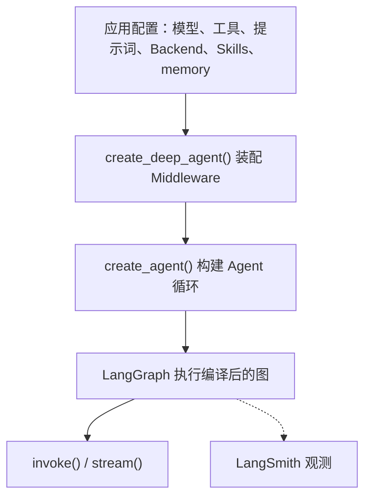

# 第 1 章：从 Agent Framework 到 Agent Harness — Deep Agents 的诞生逻辑

> 一句话总结：用 Runtime（LangGraph）→ Framework（LangChain）→ Harness（Deep Agents）三层解释 Deep Agents 的定位——把文件系统、子 Agent、上下文管理等已被验证的模式装配进 Agent 循环，并用 Context Engineering 取代把所有信息塞进 prompt。

## 1. 这一章解决什么问题

假设要做一个 AI 编程助手：读源码、理解结构、制定修改计划、分步执行并追踪进度、把子任务委派出去、跨对话记住偏好。若从零用 LangChain 搭建，就要手写文件读写工具、任务追踪、子 Agent 调度——而几乎每个“认真”的 Agent 应用都需要这些。

本章不写业务代码，先回答“已经有那么多框架，Deep Agents 为什么还要存在”。答案是：成功的 Agent 产品能力高度相似（文件系统、任务规划、子任务委派、上下文管理），Harness 把这些模式固化下来，避免每次重造。

## 2. 核心概念与机制

### 2.1 三个层次

| 层次 | 代表 | 核心价值 | 适用场景 |
|---|---|---|---|
| Runtime | LangGraph | 持久化执行、流式输出、人机协作、状态管理 | 需要精细控制的长期 Agent 与复杂工作流 |
| Framework | LangChain | 模型抽象、工具接口、Agent 循环、中间件 | 快速构建标准化 Agent 应用 |
| Harness | Deep Agents | 预置工具接口、中间件框架、子 Agent、长期记忆 | 复杂多步骤、自主性较高的任务 |

三者是自底向上构建，不是替代关系。LangChain 1.0 构建在 LangGraph 之上；`create_deep_agent()` 内部调用 `create_agent()`，最终由 LangGraph 执行编译后的图。

### 2.2 为什么需要 Harness

Claude Code、Manus、Cursor 的共同点：能读写搜索编辑文件、能拆解任务、能委派子任务、有上下文管理策略。任务足够复杂时，这些不是可选项。Harness 的价值就是把它们变成默认装配，而不是每个项目重写。

### 2.3 Context Engineering：本章的技术核心

传统做法把所有材料塞进 prompt：20 个文件、5 万 token。后果是上下文窗口溢出、注意力稀释、无法扩展到任意规模项目。

Deep Agents 改为提供**虚拟文件系统**：需要时 `read_file` 按需读，记录中间结果用 `write_file`，查找用 `grep`/`glob`，大文件用 `offset`/`limit` 只读需要的部分。上下文里只保留当前步骤真正需要的信息。

这个文件系统是虚拟且可插拔的：内存、本地磁盘、持久化数据库、远程沙箱，甚至按路径混合路由。这正是 Context Engineering 的含义——不是把信息全喂给模型，而是为模型构建高效获取和管理信息的基础设施。

### 2.4 架构：创建时如何装配



四步对应四层责任：

1. 应用提供业务配置；
2. `create_deep_agent()` 按参数与 Harness profile 组装内置与自定义 Middleware，准备工具与状态；
3. `create_agent()` 接收模型、工具、中间件与运行配置；
4. LangGraph 执行图；配置 Checkpointer 保存线程状态，配置 Store 保存跨线程数据。

**Tool、Middleware、Backend 各司其职**：Tool 是模型可请求的动作；Middleware 提供能力并控制执行环节；Backend 实现文件操作与存储。模型请求 `read_file`，文件中间件提供该工具，工具再通过 Backend 读取内容——Backend 本身不是 Agent 循环。

记忆也要分清：`memory=` 指定启动时加载哪些记忆文件；能否跨线程保存取决于存储后端；Checkpointer 保存的是线程执行状态。

### 2.5 v0.7 的默认边界

标准配置装配文件系统、子 Agent 和摘要等核心能力；任务规划需显式传入 `TodoListMiddleware`；Skills、记忆加载、人工审批需相应配置；`execute` 需要支持执行的 Backend（包括无沙箱隔离的 `LocalShellBackend`）；Interpreter 需单独启用。默认基础提示词为空，业务提示词由应用定义。

### 2.6 与竞品的差异

| 维度 | Deep Agents | Claude Agent SDK | Codex SDK |
|---|---|---|---|
| 用途 | 通用 Agent（含编程） | 把 Claude Code 循环嵌入应用 | 把 Codex 编程 Agent 嵌入应用 |
| 模型 | 模型无关（100+） | 绑定 Claude | 绑定 OpenAI |
| 语言 | Python + TypeScript | Python + TypeScript | TypeScript |
| 执行环境 | 本地 + 远程沙箱 + 虚拟文件系统 | 应用管理的进程，可容器化 | 启动并封装 Codex CLI 进程 |

Deep Agents 的差异点集中在模型无关性、可插拔 Backend 的虚拟文件系统、通过 LangGraph Store 与 `memory=` 实现的长期记忆，以及 LangSmith Deployment 的生产部署路径。

## 3. 代码与配置要点

框架层的 API 形态：

```python
from langchain.agents import create_agent

agent = create_agent(
    model="gpt-4.1",
    tools=[web_search, calculator],
    system_prompt="You are a helpful assistant."
)
```

原文特别说明：`web_search` 与 `calculator` 是应用自行实现并注册的工具，不是 LangChain 自动提供的全局函数。三个参数分别决定模型、可用工具和持续生效的行为说明。

选择起点可以按“谁负责决定执行结构”判断：

| 需求 | 起点 | 应用负责 |
|---|---|---|
| 文件操作、上下文管理、子任务委派 | `create_deep_agent()` | 业务工具、提示词、Backend、按需启用的能力 |
| 标准模型—工具循环，自定义上下文策略 | `create_agent()` | 工具与 Middleware 组合 |
| 固定步骤、条件分支、精确路径 | LangGraph `StateGraph` | 节点、边、路由 |

三者可以组合：在 LangGraph 中用固定代码校验输入，再交给 Deep Agent 研究，最后进入人工审核；也可把已有 LangGraph 工作流包装成 `CompiledSubAgent` 交给主 Agent（第 5 章）。

## 4. 实验观察（若有 notebook）

配套 notebook `notebooks/ch01/01-agent-harness.md` 用相同模型与同一个 `echo` 工具分别运行 `create_agent()` 与 `create_deep_agent()`。本次为 **offline** 模式，环境为 Python 3.12.11、`deepagents==0.7.22`、`langchain==1.4.3`、`langchain-core==1.6.6`、`langgraph==1.2.13`、`langchain-openai==1.6.7`。

观察到的差异：

| 观察项 | `create_agent` | `create_deep_agent` |
|---|---|---|
| 图节点 | `__start__`、`model`、`tools`、`__end__` | 额外出现 `PatchToolCallsMiddleware.before_agent` |
| 暴露工具 | `['echo']` | `['delete', 'echo', 'edit_file', 'execute', 'glob', 'grep', 'ls', 'read_file', 'task', 'write_file']` |

两次 `invoke` 的 `ToolMessage` 都是 `echo: hello deepagents`。这验证了“相同工具都能执行，默认装配不同”，而不是“Deep Agent 更聪明”。

几个值得记住的现象与坑：

- **可用工具 ≠ 本轮调用。** Deep Agent 有 `write_file`，但 echo 任务不会用它；清单只表示模型可以选择。
- **offline 用 `ScriptedChatModel` 固定响应。** 它验证框架机制（参数传递、`tool_call_id` 关联、`ToolMessage` 生成），不证明真实模型会正确选择工具。
- **响应列表会循环。** 两种 Agent 各完整跑一次正好消费“调用、结束”两条消息；中途失败应重启内核，否则响应位置错位。
- **脚本最后一句不是成功证据。** `assert_echo` 检查三件事：存在参数正确的调用 ID；存在同 ID、`status == "success"` 且内容匹配的 `ToolMessage`；最后一条是 `AIMessage` 且不再请求工具。
- **工具清单读取依赖内部结构。** `list_tools` 读取 `tools` 节点的 `tools_by_name`，属于锁定版本的观察辅助，不应写进生产代码。
- **`execute` 出现在该版本的默认工具清单里**，但章节说明它需要支持执行的 Backend；“已注册”不等于“当前 Backend 一定能执行”。

## 5. 常见误区

- **把三层当替代关系。** 它们是叠加关系，选哪层取决于你需要自己编码多少执行结构。
- **以为 Deep Agent 默认能读本机文件。** 默认文件工具操作 Agent 状态中的虚拟文件；真实磁盘或沙箱取决于 Backend。
- **以为有 `write_file` 就会写文件。** 注册工具与任务实际调用是两件事。
- **以为 v0.7 默认有 Todo。** `TodoListMiddleware` 需显式启用，`write_todos` 与 `todos` state channel 才会出现。
- **用一次 echo 实验推断规划、记忆或复杂任务效果。** notebook 明确说这些没有被测试。
- **把“模型无关”理解为行为一致。** 它指可切换提供商，不代表各家工具调用与扩展字段完全兼容。

## 6. 自测清单

- [ ] 我能说出 Runtime、Framework、Harness 各解决什么问题，并各举一个代表实现。
- [ ] 我能解释 Context Engineering 为何用虚拟文件系统替代 prompt stuffing，以及 Backend 可插拔的意义。
- [ ] 我能复述 `create_deep_agent()` → `create_agent()` → LangGraph 的装配与执行链路。
- [ ] 我能区分 Tool、Middleware、Backend 的职责，以及 `memory=`、Store、Checkpointer 的差别。
- [ ] 我能说明 notebook 中两种 Agent 的工具与图节点差异，并知道 offline 结果不能证明真实模型的工具选择。
