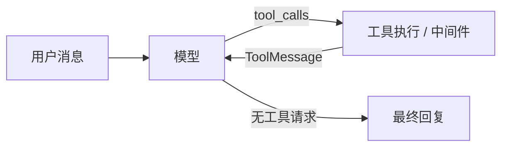

# 第 2 章：快速上手 — 5 分钟构建你的第一个 Deep Agent

> 一句话总结：用 `create_deep_agent()` 把模型、普通 Python 函数和系统提示词组装成能自主调用工具的 Agent，并通过消息记录验证“工具真的执行过”，而不是只看最终回答。

## 1. 这一章解决什么问题

本章把“看懂架构”推进到“跑起来”：安装 `deepagents`、配置模型、写第一个工具、组装研究助手，再解释一次 `agent.invoke()` 背后发生的模型—工具循环。

它同时校正了一个版本认知：v0.7 中文件系统、子 Agent 仍然默认提供，但**任务规划不再默认启用**；需要 `write_todos` 时必须显式传入 `TodoListMiddleware`。这决定了后面所有“让 Agent 自己拆步骤”的示例能否成立。

## 2. 核心概念与机制

### 2.1 工具就是带类型标注和 docstring 的 Python 函数

框架读取函数名、参数类型、默认值和 docstring，生成模型可见的工具 Schema。三要素各自对应 Schema 的一个位置：

| 要素 | 作用 | 在 Schema 中 |
|---|---|---|
| 参数类型标注 | 决定模型该传什么类型 | 参数的 `type`，如 `float` → `number` |
| docstring | 决定模型何时调用 | 工具 `description`；`Args:` 逐项变成参数说明 |
| 默认值 | 标记可选参数 | 从 `required` 消失，并带 `default` |

类型标注不是注释：notebook 里给 `amount` 传字符串 `"a lot"`，框架会在函数执行前按 Schema 拒绝。

### 2.2 一次 `invoke()` 是一个循环



`invoke()` 返回运行结束时的状态字典，`result["messages"]` 含完整历史，最后一条通常是最终回复。循环可能调用十几次工具，也可能一次都不调用；`invoke()` 不等于“调用一次模型”。

### 2.3 v0.7 的能力装配

| 能力 | 默认状态 | 启用方式 |
|---|---|---|
| 文件工具 | 默认提供 | 无需配置 |
| 子 Agent / `task` | 默认提供 `general-purpose` | `subagents=[...]` 自定义 |
| 任务规划 `write_todos` | **默认关闭** | `middleware=[TodoListMiddleware()]` |
| 上下文摘要 | 默认提供 | 阈值可配置 |
| 人工审批 | 默认关闭 | `interrupt_on=` |

### 2.4 三种模型接入方式

1. **OpenAI 兼容接口（推荐）**：`ChatOpenAI` + `base_url`，换 URL 和 Key 即可切换硅基流动、DeepSeek、智谱等平台。
2. **Anthropic 兼容接口**：`ChatAnthropic` + `base_url`。
3. **字符串格式**：`"anthropic:claude-sonnet-4-6"`、`"openai:gpt-4.1"`，适合官方 API 直连。

硅基流动同时兼容两种接口，同一平台上的模型可以按团队习惯选择 SDK；但 `base_url` 与 SDK 必须匹配，不能把 Anthropic 客户端指向 OpenAI 端点。

## 3. 代码与配置要点

安装时锁定 v0.7 系列，避免 API 漂移；Python 需 3.11+：

```bash
pip install "deepagents>=0.7,<0.8" langchain-openai
export SILICONFLOW_API_KEY="your-siliconflow-key"
export MODEL_NAME="Qwen/Qwen2.5-7B-Instruct"
```

最小 Agent：

```python
agent = create_deep_agent(
    model=model,
    tools=[get_weather],
    system_prompt="You are a helpful assistant.",
)
result = agent.invoke(
    {"messages": [{"role": "user", "content": "北京今天天气怎么样？"}]}
)
print(result["messages"][-1].content)
```

`create_deep_agent()` 的关键参数：`model`（实例或 `provider:model` 字符串）、`tools`（默认 `[]`）、`system_prompt`（v0.7 默认基础提示词为空）、`middleware`。研究助手额外加入规划：

```python
agent = create_deep_agent(
    model=model,
    tools=[internet_search],
    system_prompt=research_instructions,
    middleware=[TodoListMiddleware()],
)
```

`calculate` 演示了安全边界：只允许数字、括号和四则运算，用 `ast` 白名单节点求值，不把模型生成的文本直接交给 `eval`。`convert_currency` 用固定汇率表演示默认参数 `to_currency="CNY"`，真实场景应接汇率 API。

LangSmith 追踪是可选排障手段，`.env` 不会自动加载；Endpoint 必须与组织区域一致（US 默认 / EU / APAC），否则 Trace 不出现或上传 401/403。省略 `LANGSMITH_PROJECT` 时通常写入 `default` 项目；API Key、Endpoint 与查看 Trace 的控制台必须属于同一区域。

## 4. 实验观察（若有 notebook）

两个 notebook 均以 **offline 脚本模型**运行：模型消息预先写好，工具函数和框架真实执行，因此能验证机制，但不能证明真实模型会正确选工具。

### 4.1 Notebook（一）：一次调用拆成四条消息

Hello World 的 `result["messages"]` 是 4 条：`HumanMessage` → 空文本但带 `tool_calls` 的 `AIMessage` → `ToolMessage`（`status="success"`，内容 `It's always sunny in 北京!`，`tool_call_id="ch02-weather"`）→ 最终 `AIMessage`。状态键只有 `['files', 'messages']`，本次未写文件，`files` 为空。

计算器实验得到两对“请求 → 返回”：`convert_currency(100, "USD")` 返回 `{"amount": 720.0, "currency": "CNY"}`，`calculate("720.0 * 1.08")` 返回 `777.6`。检查器要求第二步在第一步返回**之后**发起，且算式里出现实际换算结果 `720.0`；同一次请求里并排调用两个工具会被判为“没有接上”。

Notebook 的 `calculate` 与正文写法略有不同：它先用 `re.fullmatch` 只放行数字、小数点、括号和 `+ - * /`，并额外拒绝 `**`，再调用 `eval`；正文则用 `ast` 白名单节点。两者都避免把模型生成的任意代码直接执行。

两种失败必须区分：

- `amount="a lot"` 违反 Schema → 返回 `status="error"` 的 `ToolMessage`，函数**没有运行**，错误文本提示模型改正后重试。
- `from_currency="JPY"` 类型正确但函数内 `rates["JPY"]` 抛 `KeyError` → 异常直接冲出 `invoke()`，整次运行中断。

把汇率 `7.2` 改成 `7.0` 后，换算返回 `700.0`，但脚本里写死的 `calculate("720.0 * 1.08")` 仍返回 `777.6`，检查停在“算式没有用到换算结果 700.0”。这说明每一步都“成功”不等于任务完成。

### 4.2 Notebook（二）：规划与文件真的进了状态

研究助手注册的工具共 11 个：`delete`、`edit_file`、`execute`、`glob`、`grep`、`internet_search`、`ls`、`read_file`、`task`、`write_file`、`write_todos`。offline 轨迹依次调用 `write_todos`、`internet_search`、`write_file`、`write_todos`：

- `search_log` 记录到 1 次实际搜索、3 条结果；主 Agent 直接发起 1 次，0 次子 Agent 委派。在工具函数里记录搜索是必要的：live 模式可能把搜索委派给子 Agent，而子 Agent 的调用不会出现在主消息里。
- `result["todos"]` 是最后一次提交的三项，全部 `completed`；中间的 `in_progress` 版本已被覆盖。
- `result["files"]` 只有 `/research/langgraph.md`，重启内核即消失，磁盘上没有这个文件。

`todos` 和 `files` 都属于 Agent State：前者记录计划，后者保存虚拟文件；它们不会出现在最终回答文本里，必须从返回状态读取。

删掉 `middleware=[TodoListMiddleware()]` 后，注册清单不再有 `write_todos`；脚本仍请求它，返回 `status="error"`，内容为 `write_todos is not a valid tool`。`check_research` 仍然通过，因为规划是可选行为，失败的调用不计入——这正说明“注册”“调用”“成功”是三件事。

## 5. 常见误区

- **把最终回答当证据**。模型可以编造“已查询”，必须检查 `tool_calls`、`tool_call_id`、`ToolMessage.status` 与返回值。
- **以为 `tools=[]` 就没有工具**。Deep Agents 仍会装配文件工具、`task` 等内置能力。
- **以为 `invoke()` 只调用一次模型**。它是一个循环，工具结果会再次进入模型。
- **只写类型不写 docstring**。没有 docstring 时需显式提供工具描述，否则模型难以判断调用时机。
- **认为 v0.7 默认有 Todo**。不传 `TodoListMiddleware` 就没有 `write_todos` 和 `todos` 状态。
- **用 7B 模型跑复杂编排**。章节明确提示小模型在规划、摘要、多子 Agent 场景下可能跑不通，应换 `zai-org/GLM-5.2` 等更强模型。
- **改完 `.env` 不重启进程**。已运行的 Jupyter 内核会继承旧环境变量。

## 6. 自测清单

- [ ] 我能说出 `create_deep_agent()` 的 `model`、`tools`、`system_prompt` 各自作用，并知道 v0.7 的规划要显式启用。
- [ ] 我能从 `result["messages"]` 中找到一次工具请求、对应 `tool_call_id` 的成功返回，而不是只看最后一句。
- [ ] 我能解释参数类型、docstring、默认值分别进入工具 Schema 的哪个字段。
- [ ] 我能区分 Schema 校验失败（返回 error ToolMessage）与函数内部异常（中断 `invoke()`）。
- [ ] 我能说明 offline 脚本模型验证了什么、没有验证什么，并知道如何切换到 live。
