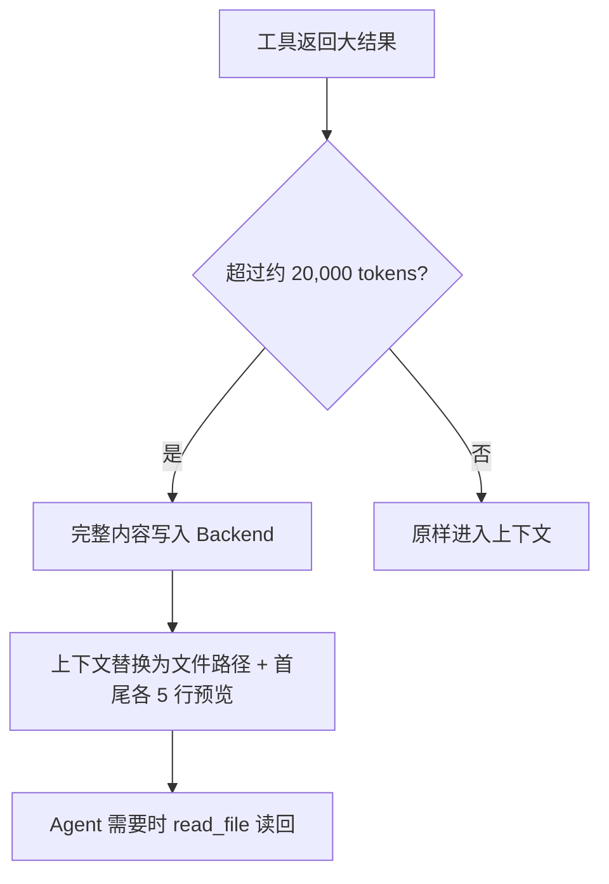

# 第 3 章：虚拟文件系统 — Deep Agents 的 Context Engineering 核心

> 一句话总结：把“文件”作为模型上下文之外的外部记忆，让 Agent 按需读写、搜索和分页读取，并用自动卸载、摘要与可插拔 Backend 把上下文控制在窗口之内。

## 1. 这一章解决什么问题

传统 Agent 把所有信息——文件内容、搜索结果、中间计算——直接塞进 prompt，后果是上下文膨胀、注意力被稀释、跨步骤信息无法复用。虚拟文件系统的做法是给 Agent 一套文件工具：需要时读取，整理后写入，用搜索定位，而不是让所有内容常驻对话。

本章的重点不是“能存文件”，而是文件与**上下文自动管理**的配合：哪些内容进入模型输入、哪些被卸载到文件、模型怎样再读回来。理解这一点，才能理解 Deep Agents 与其他 Agent 框架的设计差异。

## 2. 核心概念与机制

### 2.1 七个内置文件工具

| 工具 | 用途 |
|---|---|
| `ls` | 列出目录中的文件与元信息（大小、修改时间） |
| `read_file` | 读取内容，支持偏移量与条数；原生支持多模态格式 |
| `write_file` | 创建文件，或**完整覆盖**同路径已有文件 |
| `edit_file` | 对已有文件做精确字符串替换 |
| `delete` | 删除文件或目录 |
| `glob` | 按模式匹配路径，如 `**/*.py` |
| `grep` | 按字面量搜索内容，支持内容输出与计数 |

v0.7 的两个细节容易踩坑：`write_file` 是整体覆盖，只改局部要用 `edit_file`；`grep`、`glob` 可能返回有效但不完整的结果，并用 `truncated=True` 明示截断，Agent-facing 的 `grep` 默认最多保留 1,000 个匹配。调用成功只代表工具执行了，不代表拿到了全集。

### 2.2 `read_file`：分页与多模态

大文件默认只读前 100 行，`offset` 从 0 开始：

```python
read_file("/workspace/report.md")                    # 前 100 行
read_file("/workspace/report.md", offset=100, limit=50)  # 第 101–150 行
```

多模态支持覆盖图片（`.png` `.jpg` `.gif` `.webp` 等）、视频（`.mp4` `.mov` 等）、音频（`.wav` `.mp3` 等）和文档（`.pdf` `.ppt` `.pptx`）。但“工具能构造内容块”不等于“模型供应商接受该格式”：还需要 Backend 提供二进制内容，并选用支持对应输入模态的模型。视频抽帧要安装 `deepagents[video]`，此时 `offset` / `limit` 的单位是秒。

### 2.3 `grep` 的三种输出模式

- `files_with_matches`：只给匹配文件路径，适合快速定位。
- `content`：给匹配行及上下文，适合深入查看。
- `count`：给匹配数量，适合概览。

### 2.4 大结果自动卸载

当适用的工具**返回结果**超过约 20,000 tokens（按字符数估算，可用 `FilesystemMiddleware(tool_token_limit_before_evict=...)` 调整）时，Deep Agents 会尝试自动卸载：



这个过程不需要 Agent 主动写文件。阈值只针对工具结果，不针对工具调用参数；`read_file`、`ls`、`glob`、`grep` 等内置文件工具不走这条通用卸载路径。超长用户消息另有 `human_message_token_limit_before_evict`，默认约 50,000 tokens，不能和 20,000 混为一谈。

### 2.5 对话历史摘要

上下文达到阈值时，摘要机制会：

1. 把待总结的旧消息写入 Backend，留下可回查的历史文件。
2. 用 LLM 生成结构化摘要（意图、产出物、下一步），并附上保存路径。
3. 把**本次发给模型的内容**换成“摘要 + 近期消息”；正常摘要时，State 中的原始消息仍保留。

`create_deep_agent()` 在模型 profile 提供窗口大小时默认使用窗口的 85%，缺少信息时用固定 token 阈值。要区分“保存的历史”和“模型这次看到的内容”：摘要缩短输入，历史文件用于回查。

### 2.6 存储后端与路由

| 后端 | 文件放在哪 | 生命周期 | 适用场景 |
|---|---|---|---|
| `StateBackend`（默认） | LangGraph Agent State | 属于线程；跨 `invoke()` 需 Checkpointer + 同一 `thread_id` | 学习、草稿纸 |
| `FilesystemBackend` | 本地磁盘 | 改动直接落盘，不随线程回滚 | 本地 CLI、CI/CD |
| `LocalShellBackend` | 本地磁盘 + Shell | 同上 | 可信的个人开发机 |
| `StoreBackend` | LangGraph Store | 跨线程持久化 | 长期记忆、用户偏好 |
| `CompositeBackend` | 按路径路由到不同后端 | 混合 | 临时草稿 + 持久记忆 |
| 沙箱后端 | 隔离环境 | 沙箱会话 | 生产代码执行 |

关键差异：

- `StateBackend` 的主 Agent 与子 Agent **共享**文件，但新线程不会自动继承旧线程文件。
- `FilesystemBackend(root_dir=".", virtual_mode=True)` 把相对路径解析到 `root_dir` 下并检查越界；`virtual_mode` 不是进程隔离或安全沙箱，显式设为 `False` 时绝对路径可绕过 `root_dir`。
- `LocalShellBackend` 继承文件工具并额外提供 `execute`，命令经 `subprocess.run(shell=True)` 执行，**无沙箱隔离**；`timeout` 默认 120 秒，`max_output_bytes` 默认 100,000。
- `StoreBackend` 的 `namespace` 从 v0.5.0 起必填。本地 `invoke()` 时 `rt.server_info` 是 `None`，直接访问 `rt.server_info.user.identity` 会报错，需要兜底。
- `CompositeBackend` 按路径前缀路由；根目录 `ls` 列出默认后端内容和挂载目录，跨路由的 `glob` / `grep` 会合并结果并恢复路径前缀。v0.7 已移除 `backend=lambda rt: ...` 工厂写法，必须直接传实例。

### 2.7 权限模型

`FilesystemPermission` 在工具调用前按声明顺序求值，采用 **first-match-wins**：第一条同时匹配 `operations` 和 `paths` 的规则决定结果，没有规则匹配则默认允许。因此具体规则要放在宽泛规则之前。

| `mode` | 行为 | 场景 |
|---|---|---|
| `"allow"` | 放行 | 为特定路径开例外 |
| `"deny"` | 直接拒绝 | 绝不允许访问的路径 |
| `"interrupt"` | 暂停等待人工决策 | 敏感但可审批的操作 |

`interrupt` 需要 Checkpointer，并用 `Command(resume=...)` 恢复。特别注意：删除属于 `write` 权限类别，而目录删除是递归的。只保护 `/workspace/policies/` 前缀，会漏掉删除 `/workspace/policies`（无尾斜杠）和删除其父目录 `/workspace` 两种请求——后端一旦执行递归删除，受保护内容会一起消失。自定义后端必须在 `delete()` 里同时检查“目标是受保护目录的后代”和“目标是受保护目录的祖先”。

## 3. 代码与配置要点

默认就是 `StateBackend`，无需显式指定：

```python
agent = create_deep_agent(model=model)
```

接本地磁盘：

```python
from deepagents.backends import FilesystemBackend

agent = create_deep_agent(
    model=model,
    backend=FilesystemBackend(root_dir=".", virtual_mode=True),
)
```

混合路由：`/memories/` 持久化，其余留在 State：

```python
agent = create_deep_agent(
    model=model,
    backend=CompositeBackend(
        default=StateBackend(),
        routes={
            "/memories/": StoreBackend(
                namespace=lambda rt: (rt.server_info.user.identity,),
            ),
        },
    ),
    store=InMemoryStore(),
)
```

声明式拒绝写入：

```python
permissions=[
    FilesystemPermission(
        operations=["write"],
        paths=["/policies/**"],
        mode="deny",
    ),
]
```

自定义后端实现 `BackendProtocol` 的核心方法：`ls`、`read`、`write`、`edit`、`grep`、`glob`；要暴露 v0.7 的删除能力，还要实现 `delete()` 并返回 `DeleteResult`。外部存储的写入结果中 `files_update=None`。

需要审计、限流或内容检查时，可以继承现有后端（`GuardedBackend`）或包装任意后端（`PolicyWrapper`）。删除保护要按目录层级判断：

```python
def denied_by_directory(path, protected_dirs, *, deleting=False):
    target = policy_path(path)
    return any(
        target.is_relative_to(directory)
        or (deleting and directory.is_relative_to(target))
        for directory in protected_dirs
    )
```

`is_relative_to()` 包含路径相等，所以 `/policies` 与 `/policies/rules.txt` 都受保护，而 `/policies-copy` 不会被误拦。前面的 `policy_path` 负责补起始斜杠、折叠重复斜杠和 `.`，并拒绝包含 `..` 的路径；所有保护判断都应基于规范化后的虚拟路径。

## 4. 实验观察（若有 notebook）

本章无配套 notebook。以下实践建议都可在本地直接验证，但不要把预期现象当成已经运行过的结果。

### 实践建议

1. 用默认 `StateBackend` 写一个文件，打印 `result["files"]` 看路径与内容；换一个新 `thread_id`（或不传 Checkpointer）再问同一文件，确认新线程读不到。
2. 造一个超过 100 行的文件，分别用默认读取、`offset=100`、`offset=100, limit=50`，核对分页信息和下一段偏移量。
3. 注册一个返回长文本的自定义工具，观察是否出现“路径 + 首尾预览”的卸载结果；再调小 `tool_token_limit_before_evict` 复现。
4. 写两条权限规则，把宽泛 `allow` 放在具体 `deny` 之前，确认 first-match-wins 会让拒绝规则失效；再调换顺序对比。
5. 在临时目录用 `FilesystemBackend(virtual_mode=True)` 尝试 `../` 路径，理解“路径越界检查”与“进程隔离”的区别。

## 5. 常见误区

- **把虚拟文件当磁盘文件**。默认 `StateBackend` 的文件只在 Agent State 里，重启进程就消失。
- **以为 `read_file` 默认读全文**。它默认最多 100 行，必须用 `offset` / `limit` 翻页。
- **把“调用成功”当“结果完整”**。`grep`、`glob` 可能 `truncated=True`，需要缩小目录或匹配条件继续搜索。
- **以为 `StateBackend` 跨线程自动共享**。同线程内主/子 Agent 共享，新线程不继承，除非 Checkpointer 保存并恢复。
- **把 `virtual_mode` 当安全沙箱**。它只做路径解析与越界检查，不是隔离机制。
- **在生产环境用 `FilesystemBackend` 或 `LocalShellBackend`**。前者能读 `.env` 和密钥，后者能执行任意 Shell 命令。
- **只用前缀保护目录**。删除 `/workspace` 会递归带走 `/workspace/policies`，必须加祖先检查。
- **继续使用 `backend=lambda rt: ...`**。v0.7 已移除该写法，`namespace=lambda rt: ...` 则仍然有效。

## 6. 自测清单

- [ ] 我能列出七个文件工具，并说出 `write_file` 与 `edit_file` 的分工。
- [ ] 我能解释大结果卸载的触发条件、写入位置、上下文替换形式和读回方式。
- [ ] 我能根据“临时 / 本地 / 跨会话 / 混合 / 隔离执行”选择合适 Backend，并说明各自风险。
- [ ] 我能写出 first-match-wins 的权限规则，并解释为什么删除需要额外的祖先目录检查。
- [ ] 我能说出自定义后端需要实现哪些 `BackendProtocol` 方法，以及 `delete()` 为什么不能省略。
