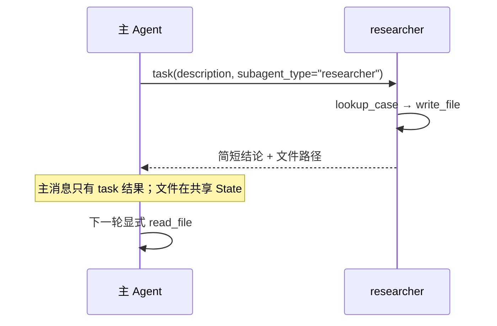

# 第 5 章：子 Agent 与上下文隔离 — 让 Agent 学会“委派”

> 一句话总结：主 Agent 通过 `task` 把子任务交给独立上下文的子 Agent，只收回精炼结果；消息记录被隔离，但共享 Backend 的文件状态仍会回到主 Agent。

## 1. 这一章解决什么问题

一个研究子任务可能包含 5 次搜索、每次 3000+ tokens 的结果、多次 `write_file` 和 `read_file`。这些中间过程如果全留在主 Agent 的对话里，上下文很快膨胀；而主 Agent 其实不需要知道每次搜索的细节，只需要最终摘要。

子 Agent 的核心动机就是 **Context Quarantine（上下文隔离）**：子 Agent 在独立消息上下文中执行，只把最终结果返回主 Agent。主 Agent 像项目经理，不必参加每场技术讨论，只看负责人提交的总结。

适用判断：

| 场景 | 用子 Agent？ | 理由 |
|---|---|---|
| 多次搜索与整理的研究任务 | ✅ | 中间结果会膨胀主上下文 |
| 需要专用工具或指令的任务 | ✅ | 子 Agent 可有自己的工具与提示词 |
| 需要不同模型能力 | ✅ | 子 Agent 可指定不同模型 |
| 高层协调的复杂任务 | ✅ | 主 Agent 协调，子 Agent 执行 |
| 单步简单查询 | ❌ | 委派开销大于收益 |
| 主 Agent 必须看到完整调用过程 | ❌ | 主 Agent 只收到最终结果 |

## 2. 核心概念与机制

### 2.1 同步委派的数据流



同步委派意味着主 Agent 的这次 `task` 调用要等子 Agent 返回才能继续；整个过程在同一 Python 进程内完成。消息隔离不等于文件隔离，也不等于安全沙箱。

### 2.2 字典定义的字段与继承规则

最常用的是字典声明，必填 `name`、`description`、`system_prompt`：

| 字段 | 必填 | 继承主 Agent？ | 说明 |
|---|---|---|---|
| `name` | ✅ | — | 唯一标识，主 Agent 用它指定 `subagent_type` |
| `description` | ✅ | — | 主 Agent 据此决定何时委派给谁 |
| `system_prompt` | ✅ | ❌ | 子 Agent 自己的指令，必须独立定义 |
| `tools` | 可选 | ✅ 默认继承，指定后完全替换 | 不指定则继承主 Agent 显式传入的 `tools`；中间件注入的文件工具不因此移除 |
| `model` | 可选 | ✅ 默认继承 | 可用 LangChain 对象或 `"provider:model"` 字符串 |
| `middleware` | 可选 | ❌ | 子 Agent 自己的中间件 |
| `interrupt_on` | 可选 | ✅ 默认继承 | 可覆盖主 Agent 的审批配置 |
| `skills` | 可选 | ❌ | 指定后运行独立的 `SkillsMiddleware`，技能状态完全隔离 |
| `response_format` | 可选 | ❌ | 结构化输出 schema，需 `deepagents>=0.5.3` |
| `permissions` | 可选 | ✅ 默认继承，指定后完全替换 | 文件系统权限规则 |

这几条替换与不继承规则要特别小心：`tools`、`permissions` 一旦显式提供就是整体替换，不是与父级叠加；`skills` 则根本不继承——主 Agent 的 `skills` 只传给 `general-purpose`，其他声明式子 Agent 要自己配置。

### 2.3 默认的 `general-purpose`

不定义任何子 Agent 时，Deep Agents 也自带一个通用子 Agent，主 Agent 可用 `task(subagent_type="general-purpose", ...)` 委派。

它继承主 Agent 显式传入的 `tools`、`model` 和 `skills`，但使用自己的 `DEFAULT_SUBAGENT_PROMPT` 并应用当前模型的 Harness Profile，**不继承主 Agent 的 `system_prompt`**。这个“不继承自定义提示词”的行为始于 0.0.6，不是 v0.7 新增。

中间件继承范围更窄：只继承主 Agent 对默认中间件的同名覆盖，按 `.name` 匹配；不会带上仅为主 Agent 新增的中间件。因此主 Agent 的 `TodoListMiddleware` 不会传给它。

### 2.4 禁用、覆盖与启用 Todo

**禁用**默认子 Agent 需要两步：为匹配的模型注册 Harness Profile，关闭 `general_purpose_subagent`；同时传 `subagents=[]`，不注册其他同步子 Agent。

```python
register_harness_profile(
    key="openai:zai-org/GLM-5.2",
    profile=HarnessProfile(
        general_purpose_subagent=GeneralPurposeSubagentProfile(enabled=False)
    ),
)
agent = create_deep_agent(model=model, subagents=[])
```

`key` 必须与实际的模型标识匹配：这里的 `model` 应是 `ChatOpenAI(model="zai-org/GLM-5.2", ...)` 这类与 key 对应的模型，把 key 原样用于其他模型不会让关闭配置生效。

不要用 `excluded_middleware` 排除 `SubAgentMiddleware`，那会直接抛 `ValueError`。

**覆盖**用 `name="general-purpose"` 的同名 spec，可单独设置提示词、模型和工具。**启用 Todo** 也在同名 spec 的 `middleware` 中加 `TodoListMiddleware()`；主、子两处配置相互独立，子 Agent 不会读写主 Agent 的 `todos`。其他声明式子 Agent 同理。

### 2.5 `CompiledSubAgent`

需要多步骤、有分支逻辑时，可以把预构建的 LangGraph 图包装成子 Agent：

```python
data_subagent = CompiledSubAgent(
    name="data-analyzer",
    description="执行复杂的数据分析任务，包括统计分析和图表生成",
    runnable=custom_graph,
)
```

硬性要求：图的 State 中必须包含 `"messages"` 键。大多数简单场景仍推荐字典方式，配置更直观。

### 2.6 结构化输出

`response_format` 接收 Pydantic schema。子 Agent 成功生成 `structured_response` 时，中间件会把它序列化为 JSON 放进 `ToolMessage`，主 Agent 收到的是 JSON 字符串而非自由文本。默认情况下，0.7.10 会从后向前寻找最后一条含非空文本的 AI 消息。

设置 schema 不代表每次委派都成功：模型或工具仍可能失败，应用要保留错误处理和结果校验。

## 3. 代码与配置要点

定义一个研究型子 Agent：

```python
research_subagent = {
    "name": "researcher",
    "description": "深入研究特定主题，搜索多个信息源并整理成摘要",
    "system_prompt": """你是一位专业的研究员。你的任务是：
1. 把研究问题拆解为多个搜索查询
2. 用 internet_search 搜索相关信息
3. 整理发现，写成简洁摘要
4. 列出关键发现和信息来源

注意：返回结果控制在 500 字以内，只返回核心发现。""",
    "tools": [internet_search],
    "skills": ["/skills/research/"],
}

agent = create_deep_agent(
    model="google_genai:gemini-3.1-pro-preview",
    skills=["/skills/main/"],
    subagents=[research_subagent],
)
```

这里 `researcher` 只获得 `/skills/research/`，不获得主 Agent 的 `/skills/main/`。

覆盖默认子 Agent：

```python
agent = create_deep_agent(
    model=model,
    tools=[internet_search],
    subagents=[{
        "name": "general-purpose",
        "description": "通用助手，处理各种委派任务",
        "system_prompt": "你是一个通用助手。",
        "tools": [internet_search],
        "model": ChatOpenAI(
            model="zai-org/GLM-5.2",
            api_key=os.environ["SILICONFLOW_API_KEY"],
            base_url="https://api.siliconflow.cn/v1",
        ),
    }],
)
```

结构化输出：

```python
class ResearchFindings(BaseModel):
    summary: str = Field(description="研究摘要")
    confidence: float = Field(description="置信度 0-1")
    sources: list[str] = Field(description="信息来源 URL 列表")

research_subagent = {
    "name": "researcher",
    "description": "研究特定主题并返回结构化发现",
    "system_prompt": "深入研究给定主题，返回你的发现。",
    "tools": [internet_search],
    "response_format": ResearchFindings,
}
```

最佳实践可以归纳为五条：`description` 写清“什么情况下用它”；`system_prompt` 包含输出格式与字数上限；工具集按最小权限精简；不同子 Agent 可选不同模型；返回结果必须精简，否则上下文隔离失去意义。子 Agent 若产生大量原始数据，应先 `write_file` 落盘，只返回分析摘要。

## 4. 实验观察（若有 notebook）

Notebook 使用本地固定的 A/B 缓存方案资料，不调用搜索服务。案例数据是教学值：方案 A 的 p95 延迟 420 ms，超过 150 ms 上限；方案 B 为 95 ms、每 5 分钟更新、错误率 0.6%，三项约束都满足。因此预期结论是选 B。

脚本模型根据 `tool_names` 判断当前角色：只有 `researcher` 注册了 `lookup_case`；主 Agent 第一轮发 `task` 委派，第二轮按用户要求发 `read_file`。这些是预设决策，验证的是工具执行与数据传递，不是模型的比较能力。

### 4.1 主 Agent 只看到 `task` 结果

第一轮 `first_result["messages"]` 只有 4 条：用户消息、带 `task` 调用的 `AIMessage`、名为 `task` 的 `ToolMessage`、最终回复。检查输出：

```text
主 Agent 收到的工具结果名: ['task']
```

`lookup_case` 和 `write_file` 都**不在**主消息里；它们只出现在子 Agent 自己的上下文中。`task` 的返回是：

```text
方案 B 满足约束，报告位于 /research/cache-choice.md。
```

而 `lookup_case` 实际读到的 A/B 资料记录在 Python 的 `lookup_trace` 里——这提醒我们，主 Agent 看不到子 Agent 的内部调用，但外部程序仍可通过工具函数的副作用观察。

### 4.2 文件状态是共享的

子 Agent 写完后，`first_result["files"]["/research/cache-choice.md"]` 已包含完整报告：

```markdown
[A] p95 420 ms，错误率 0.4%。
[B] p95 95 ms，错误率 0.6%。
[约束] p95 <150 ms；最多延迟5分钟；错误率 <1%。
结论：方案 B 满足约束。
```

此时主 Agent 的消息里还没有报告正文。**在 Notebook 里 `display` 文件，不会自动把内容发给模型**，这正是“消息隔离、文件共享”可以同时成立的原因。

### 4.3 第二轮主动读取才进入上下文

本例没有配置跨调用持久化，第二次 `invoke` 必须显式传回消息和文件：

```python
second_result = agent.invoke({
    "messages": [
        *first_result["messages"],
        {"role": "user", "content": f"请使用 read_file 读取 {REPORT_PATH}，再简短告诉我报告的结论。"},
    ],
    "files": first_result["files"],
})
```

`read_file` 返回头是 `@@ lines 1-4 of 4 @@`，报告正文这时才作为 `ToolMessage` 进入主 Agent 上下文。

练习很有价值：去掉 `"files": first_result["files"]` 后，聊天记录里仍有文件路径，但新一轮状态里没有这个文件，`read_file` 读不到内容，断言在“读回内容与共享状态一致”处失败。**聊天里的路径不等于状态里的文件。**

## 5. 常见误区

- **以为子 Agent 能看到主 Agent 的全部对话**。它只收到 `task` 的 `description`，在独立上下文里工作。
- **以为文件也隔离**。默认 `StateBackend` 下主、子 Agent 共享文件；消息隔离与文件共享是两件事。
- **把 `tools=[]` 理解为“没有工具”**。Deep Agents 仍会装配 `task`、文件操作等内置工具。
- **以为声明式子 Agent 继承 `skills`**。只有 `general-purpose` 获得主 Agent 的 `skills`，其他子 Agent 要显式配置。
- **以为 Todo 会自动继承**。主、子 Agent 的 `TodoListMiddleware` 相互独立，子 Agent 的清单也不回写主 Agent。
- **以为 `permissions` 会叠加**。显式提供后是整体替换，只读子 Agent 要写出闭合的权限集。
- **`description` 写得含糊**。主 Agent 靠它路由，模糊描述会导致不委派或委派错对象。
- **子 Agent 返回大段原始数据**。这会抵消上下文隔离的收益，应在提示词中强制摘要或先落盘。
- **以为设置 `response_format` 就一定成功**。模型或工具仍可能失败，仍需校验。
- **给 `CompiledSubAgent` 传任意图**。其 State 必须包含 `"messages"`。

## 6. 自测清单

- [ ] 我能解释 Context Quarantine 解决什么问题，并判断一个任务该不该委派。
- [ ] 我能写出字典式子 Agent 的三个必填字段，并说明 `tools`、`skills`、`permissions` 的继承/替换规则。
- [ ] 我能说明 `general-purpose` 继承什么、不继承什么，以及如何禁用它。
- [ ] 我能从 `task` 的 `tool_calls` 与 `ToolMessage` 验证委派发生，并解释为什么主消息里没有子 Agent 的工具记录。
- [ ] 我能解释“消息隔离、文件共享”，并知道跨 `invoke()` 要显式传回 `files`。
