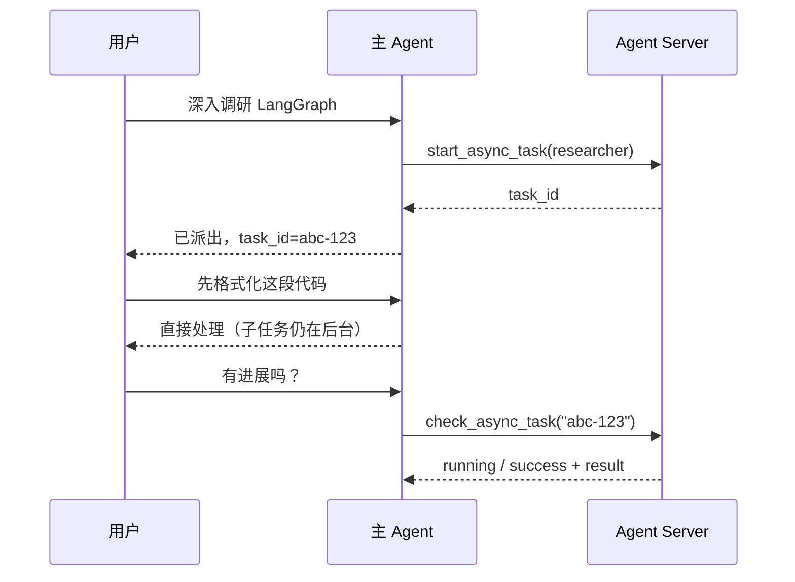

# 第 6 章：异步子 Agent — 让主 Agent 同时驱动多个子任务

> 一句话总结：异步子 Agent 把长任务提交到 Agent Server 的独立 thread 上后台执行，`start_async_task` 成功即返回 task ID 并交还控制权，之后靠 `check` / `update` / `cancel` / `list` 远程管理，而不是让主对话一直等待。

## 1. 这一章解决什么问题

第 5 章的同步子 Agent 由主 Agent 调用 `task` 后原地等待。子任务若要做深度调研、代码迁移、批量数据处理，可能要跑几分钟到几十分钟；这段时间里主 Agent 被阻塞，用户既不能继续聊别的话题，也不能中途补充约束（“换个数据源”“加上 2024 年的数据”）。同步模式也没有专用的更新或取消工具。

异步子 Agent 针对两点：**主线对话不必等待子任务完成**；**任务可以中途追加指令或取消**。作者的判定法则是：子任务能在 5 秒内完成用同步；可能跑数分钟以上、且过程需要交互，用异步。

它并未消灭等待：`start_async_task` 仍要等服务端创建 thread 和 run 成功后才返回 task ID；变化在于不再等子任务执行完。该特性自 `deepagents>=0.5.0` 起作为预览引入，API 可能变化。

## 2. 核心概念与机制

### 2.1 四个容易混淆的层次

| 名称 | 本章职责 |
|---|---|
| Agent Protocol | 调用 Agent 的 API 规范：建会话、启动运行、查状态、取消等 |
| Agent Server | 实现这些接口的运行服务，加载 Agent 代码并调度执行 |
| LangSmith Deployment | 部署和运行 Agent Server 的平台能力，也可用自托管兼容服务 |
| LangSmith Observability | 采集 trace，查看模型调用、工具执行、耗时与错误 |

开启 LangSmith 追踪会记录执行过程，但**不会**把本地 Agent 变成能接收任务的服务。本章用 `langgraph dev` 启动本地 Agent Server，无需先上云。

### 2.2 thread、run 与 task ID

服务端的 **thread 是保存消息和状态的会话，不是操作系统线程**；**run 是该会话上的一次执行**。`start_async_task` 通过 SDK 新建子任务的 thread 和 run，等待这两个创建请求成功后，把 **thread ID 作为 task ID** 返回；服务端继续执行子 Agent。

| 名称 | 含义 | 更新任务时 |
|---|---|---|
| `graph_id` | 服务端注册的图 / assistant | 不变 |
| `thread_id` | 保存消息与状态的子会话 | 不变 |
| `task_id` | 主 Agent 跟踪子任务的编号，本章等于子 thread ID | 不变 |
| `run_id` | 这段会话上的某一次执行编号 | 换成新 run |

因此“更新”不是修改原 run，而是在同一 thread 上以 `interrupt` 多任务策略发起新 run：前一次 run 被打断，子 Agent 带着完整对话历史和新指令重新启动，task ID 保持不变。

### 2.3 主 Agent 的五把“遥控器”

声明 `AsyncSubAgent` 后，`AsyncSubAgentMiddleware` 自动注入五个工具：

| 工具 | 作用 | 返回 |
|---|---|---|
| `start_async_task` | 启动后台任务 | task ID（启动成功即返回） |
| `check_async_task` | 查询状态与结果 | 状态；完成时附结果 |
| `update_async_task` | 给运行中的任务追加指令 | 确认 + 更新后状态 |
| `cancel_async_task` | 终止运行中的任务 | 确认信息 |
| `list_async_tasks` | 列出所有跟踪任务 | 任务总览 |

底层行为值得记住：`start` 建 thread + run，**不轮询等待**；`check` 读 run 状态，完成后再读 thread state 取最终输出，运行中只给状态和 thread ID，**不提供步骤级进展或 ETA**；`update` 在同一 thread 发起新 run；`cancel` 调用 `runs.cancel()` 并把本地任务标为 `"cancelled"`；`list` 对已结束任务用缓存，未结束的并发向服务端拉实时状态，查询失败回退缓存。



### 2.4 为什么任务元数据要单开 `async_tasks` channel

主 Agent 的 graph state 中有独立于消息历史的 `async_tasks` 通道，保存 task ID、子 Agent 名、thread ID、run ID、状态、`created_at`、`last_checked_at`、`last_updated_at`。原因是 Deep Agents 上下文逼近上限时会**自动压缩对话历史**；如果任务 ID 只活在某条 ToolMessage 里，压缩后主 Agent 就会“忘了”自己派出的任务，再也无法 check 或 cancel。

这与虚拟文件系统、TodoList 是同一设计哲学：**会被截断的放消息历史，必须长存的进 state channel**。但 `async_tasks` 不是跨所有线程的全局任务目录；跨调用和重启恢复仍依赖主线程的 Checkpointer 持久化。

### 2.5 两种传输与三种拓扑

```text
HTTP 传输：SDK → 网络连接 → Uvicorn → Agent Server 应用
ASGI 传输：SDK → 进程内 ASGI 适配器 → Agent Server 应用
```

- **ASGI（同部署）**：主 Agent 与子 Agent 注册在同一份 `langgraph.json`，`AsyncSubAgent` 省略 `url`。省去 SDK 到 Server 的网络往返，无需额外鉴权，但应用处理、调度和状态存储仍有开销。ASGI 需要主 Agent 通过 `ainvoke()` 等异步入口执行，**不支持同步 `invoke()`**。
- **HTTP（远程）**：填写 `url` 即走网络；LangGraph 部署从 `LANGSMITH_API_KEY` / `LANGGRAPH_API_KEY` 自动鉴权，自托管服务可用 `headers`。

| 拓扑 | 形态 | 场景 |
|---|---|---|
| 单部署 | 全部 ASGI | 绝大多数项目的起点 |
| 拆分部署 | 主、子各一台，全 HTTP | 子 Agent 资源画像或扩缩容策略不同 |
| 混合 | 部分 ASGI、部分 HTTP | 多数同部署，少数单独扩 |

## 3. 代码与配置要点

### 3.1 声明子 Agent

`AsyncSubAgent` 只是一份“调用哪个服务中的哪个 Agent”的配置，不会创建子 Agent 实现，也不会启动服务器。

```python
from deepagents import AsyncSubAgent, create_deep_agent

async_subagents = [
    AsyncSubAgent(
        name="researcher",
        description="深度研究 Agent，用于多次搜索 + 信息综合的调研任务",
        graph_id="researcher",
        # 不传 url → 使用 ASGI 进程内传输（与主 Agent 同部署在一个 server）
    ),
    AsyncSubAgent(
        name="coder",
        description="编码 Agent，用于代码生成、改写与代码评审",
        graph_id="coder",
        # url="https://coder-deployment.langsmith.dev"   # 可选：远程 HTTP 传输
    ),
]

agent = create_deep_agent(
    model="google_genai:gemini-3.5-flash",
    subagents=async_subagents,
)
```

`name` 供主 Agent 选择，`description` 决定何时委派，`graph_id` 必须与服务端注册名一致；`url` 可选，`headers` 仅远程模式使用。

### 3.2 同部署注册

```json
{
  "dependencies": ["./"],
  "graphs": {
    "supervisor": "./graphs/supervisor.py:graph",
    "researcher": "./graphs/researcher.py:graph"
  },
  "env": "./.env"
}
```

`supervisor` 和 `researcher` 同时在 `graphs` 中，`AsyncSubAgent` 才能用 ASGI 直接调用 `researcher`。`langgraph dev` 会提供持久化组件，此处不要手动传入 `checkpointer`。本地启动：

```bash
langgraph dev --n-jobs-per-worker 4
```

每个活跃 run 占一个 worker 槽位；一个主 Agent 同时跑 3 个子 Agent 至少需要 4 个槽位，槽位不足时新任务排队，表现为 `start_async_task` 长时间不返回或 `check` 长时间无进展。

### 3.3 一个故意很慢的子图

```python
import asyncio

from langgraph.graph import END, START, MessagesState, StateGraph


async def slow_research(state: MessagesState):
    last_human = state["messages"][-1].content if state["messages"] else "No task provided."
    await asyncio.sleep(8)
    return {
        "messages": [
            {
                "role": "ai",
                "content": (
                    "[researcher finished after 8s]\n"
                    f"latest task: {last_human}\n"
                    "summary: async subagents return a task ID immediately, "
                    "run in the background, and can be checked or updated later."
                ),
            }
        ]
    }


builder = StateGraph(MessagesState)
builder.add_node("slow_research", slow_research)
builder.add_edge(START, "slow_research")
builder.add_edge("slow_research", END)
graph = builder.compile()
```

固定 sleep 是为了制造可观察窗口，不是研究能力的演示。

### 3.4 主 Agent 的提示词约定

```python
import os

from deepagents import AsyncSubAgent, create_deep_agent

graph = create_deep_agent(
    model=os.environ.get("MODEL_NAME", "openai:gpt-4.1-mini"),
    system_prompt=(
        "You are a supervisor agent for an async-subagent demo. "
        "When the user asks for a long-running research task, you must delegate "
        "to the async subagent named researcher immediately. "
        "After calling start_async_task, return the task_id to the user and stop. "
        "Do not call check_async_task unless the user explicitly asks for progress. "
        "If the user asks to revise the background task, call update_async_task."
    ),
    subagents=[
        AsyncSubAgent(
            name="researcher",
            description=(
                "Use for any long-running background research or async demo task. "
                "This agent intentionally sleeps before returning so the async "
                "behavior is easy to observe."
            ),
            graph_id="researcher",
        )
    ],
)
```

关键点：启动后立刻交还控制权，不要自动轮询，否则异步会退化成伪同步。

### 3.5 用 SDK 验证

```python
import asyncio

from langgraph_sdk import get_client

client = get_client(url="http://127.0.0.1:2024")


async def main():
    thread = await client.threads.create()
    first = await client.runs.wait(
        thread["thread_id"],
        "supervisor",
        input={"messages": [{"role": "user", "content": (
            "请把这个任务交给 researcher 异步处理："
            "用后台任务总结 async subagent 的关键行为。"
        )}]},
    )
    print(first)


asyncio.run(main())
```

`runs.wait` 等的是**主图这一轮**返回，不会等 researcher 完成，所以之后还要查询子任务。

## 4. 实验观察

配套 Notebook 在本机启动真实 Agent Server，用 ASGI 委派；模型侧默认 offline 脚本按 `START|...`、`CHECK|...`、`LIST`、`UPDATE|...`、`CANCEL|...` 命令映射到五个工具。执行版本为 `deepagents==0.7.22`（正文片段按 0.7.10 核对），服务、SDK、thread、run 都真实运行。

可复现现象：

| 阶段 | 实际观察 |
|---|---|
| 启动 | `Launched async subagent. task_id: 01a12f55-d43c-78d1-8776-777dd9a01d8c` 立即返回；紧接着 `runs.get` 显示 `pending` |
| 列举 | `list_async_tasks` 显示 1 个任务，状态 `running` |
| 查询 | 首次 `check` 只返回 `status: running` 和 `thread_id`；约 8 秒后变成 `success`，并带 `result: Research completed: 总结异步任务的状态变化` |
| 更新 | task ID 不变、`run_id` 改变；轮询结果为 `Research completed: 追加要求：使用三条要点` |
| 取消 | 本地 `async_tasks` 立即变 `cancelled`；服务端 run 最终为 `interrupted`（也可能是 `cancelled`） |
| 收尾 | `LIST` 显示 3 个任务，前两个 `success`，第三个 `cancelled`；汇总为“完成 → success / 更新 → success / 取消 → interrupted” |

这些输出证明了三件事：**返回 task ID 不等于任务完成**；**更新保留任务但新建 run，追加文本确实进入子图**；**取消要分别核对主 Agent 跟踪状态与服务端执行终态**。

重要坑与边界：

- Notebook 的 researcher 只回显最近一条用户文本，`Research completed` 是固定前缀，**不能当作真实研究质量的证据**。
- 主图 `state["async_tasks"][task_id]["status"]`（`running` / `success` / `cancelled`）与服务端 `runs.get(...)["status"]`（`pending` / `running` / `success` / `interrupted`）是两个层次，不要求字符串相同。
- 取消是异步生效的；`list_async_tasks` 会直接复用本地 `cancelled` 缓存，不能用它证明服务端已停止。取消也不会撤销已经发生的外部副作用。
- 8 秒观察窗可能被模型延迟吃掉：首次返回时子任务可能已完成，断言会失败。应增大等待时间后重跑，而不是删断言。
- offline 脚本模型不证明真实模型会选对工具；截至 2026-10-06 本章 live 尚无整本通过记录。
- 实验用 40 秒作为观察上限，不代表任务必定在此时间内完成。

## 5. 常见误区

- **把 thread 当成操作系统线程**：它是保存消息与状态的会话；run 才是执行。
- **`start_async_task` 返回就以为任务完成**：它只证明 thread/run 创建成功，之后必须 `check`。
- **以为 `AsyncSubAgent` 会创建或启动子 Agent**：它只是配置，子图必须另行实现并注册。
- **`graph_id` 与服务端注册名不一致**：尤其注意大小写和下划线，会报找不到 Agent。
- **用同步 `invoke()` 跑 ASGI 传输**：必须走 `ainvoke()` 等异步入口。
- **报告对话历史里的旧状态**：历史状态永远过时，回答进度前必须重新 `check`。
- **截断 task ID**：`abc-123-def-456` 缩写成 `abc-123` 会导致 check / cancel 找不到任务。
- **以为 `async_tasks` 是全局任务表**：它随主线程状态保存，跨线程不可见。
- **worker 不够**：`start_async_task` 或后续 `check` 长时间无进展，先加大 `--n-jobs-per-worker`。

## 6. 自测清单

- [ ] 能解释同步与异步子 Agent 在执行模型、并发性、更新、取消、状态性上的差异，并说出选择判据。
- [ ] 能画出 `start → check → update → cancel → list` 的生命周期，并说明 task ID、thread ID、run ID 在更新前后如何变化。
- [ ] 能独立写出 `langgraph.json` 注册、`AsyncSubAgent(graph_id=...)` 声明与 `langgraph dev --n-jobs-per-worker` 启动的最小组合。
- [ ] 能说明为什么任务元数据放在 `async_tasks` channel，而不是某条 ToolMessage 里。
- [ ] 能区分主 Agent 跟踪状态与服务端 run 终态，并解释为什么取消后仍要再查服务端且不能假设副作用被回滚。
