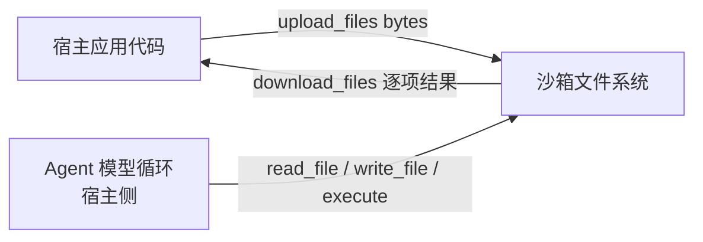

# 第 10 章：沙箱执行 — 让 Agent 安全地运行代码

> 一句话总结：把 Agent 的文件操作与 Shell 命令交给实现了 `execute()` 的沙箱 Backend，在保留编程能力的同时，用隔离、文件传输、生命周期与凭证策略把宿主机挡在边界之外。

## 1. 这一章解决什么问题

能写文件、运行 Shell、安装依赖的 Agent 已经不只是“回答问题”的模型，而是能改变运行环境的执行者。本章要解决的是：既让 Agent 可以编程、分析数据、运行测试，又让宿主机的文件、进程和凭证留在沙箱边界之外。

正文先拆清三层容易混淆的能力，再分别展开：

1. **Deep Agents Python Backend**：把远程沙箱接到 `create_deep_agent()`，为 Agent 提供文件工具与 `execute`。
2. **Deep Agents Code（`dcode`）**：CLI 在本机跑 LLM 循环，把工具调用定向到远程沙箱。
3. **LangSmith Sandboxes**：一方托管产品，除 Backend 外还提供快照、服务 URL、Auth Proxy、挂载和 CLI。

关键立场：沙箱是一种 **Backend（执行环境）**，不是权限开关。普通 Backend（`StateBackend`、`FilesystemBackend`、`StoreBackend`）只实现文件读写；沙箱 Backend 额外实现 `execute()`。

## 2. 核心概念与机制

### 2.1 协议决定模型能否看到 `execute`

Deep Agents 在每次模型调用前检查 Backend 是否实现 `SandboxBackendProtocol`；只有满足协议，模型才会看到 `execute` 工具。`BaseSandbox` 用命令或脚本实现列举、读取、搜索、删除，写入走 `upload_files()`。在 `deepagents==0.7.15` 中，自定义子类必须实现 `execute()`、`upload_files()`、`download_files()` 和 `id`，不能只实现命令执行。

协议只表示“能执行命令”，不保证远程或隔离：`LocalShellBackend` 同样实现该协议，却直接在本机执行。`FilesystemPermission` 也不是沙箱内的命令隔离——它只约束内置文件工具，不约束 `execute`。

### 2.2 返回值语义

`execute` 返回合并后的标准输出与错误输出、退出码、输出过大时的截断提示。`execute()` 返回 `ExecuteResponse(output, exit_code, truncated)`，**没有 `error` 字段**：命令失败用非零 `exit_code` 表示并在 `output` 中保留说明，上传、下载等文件操作才使用各自结果的 `error`。直接调用 Backend 时应检查 `result.exit_code`；Agent 侧退出码放在 `ToolMessage.artifact["exit_code"]`。工具接口成功返回时消息状态可能仍是 `success`，即使退出码非零，**不能只凭消息状态判断程序成功**。超大输出会保存为文件并提示用 `read_file` 分段查看，避免挤占上下文。

### 2.3 隔离边界保护什么、不保护什么

沙箱把文件系统与 Shell 操作同宿主机隔离，但**不能**单独防御两类风险：

| 风险 | 仍然存在的原因 | 应对 |
|---|---|---|
| 上下文注入 | 攻击者影响输入后仍可诱导 Agent 在沙箱内执行命令 | 不把秘密放进沙箱、审查高风险工具、使用 HITL |
| 网络外传 | 未限制网络时可用 HTTP 或 DNS 把数据发出 | 不需要网络时阻断、最小化数据、监控出站 |

例如 Modal 支持 Python SDK 的 `block_network=True`。安全目标不是“沙箱内绝不出错”，而是错误、恶意输入和不可信产物不能越过宿主边界。

### 2.4 两种集成模式

| 模式 | Agent 位置 | 代价与适用条件 |
|---|---|---|
| Agent in sandbox | 框架与工具都在沙箱内 | 需构建镜像、提供通信层，API Key 会落在沙箱内；仅当必须复现本地环境时考虑 |
| Sandbox as tool | LLM 循环、记忆、调度在宿主，执行调用远程 | 每次工具调用有网络延迟；多数应用的首选 |

镜像片段只解决运行环境（`FROM python:3.11` + `pip install deepagents-code`），不解决密钥问题：Agent 能读容器环境变量，提示注入同样可让它外传。

### 2.5 文件有两个平面



- Agent 平面：`read_file`、`write_file`、`edit_file`、`delete`、`ls`、`glob`、`grep`、`execute`，只在沙箱内部完成任务。
- 宿主平面：`upload_files()` / `download_files()`，跨越宿主与沙箱边界；路径用绝对路径，内容是 `bytes`。下载结果每个文件独立成功或失败。

内置 `write_file` 内部也可能调用 `upload_files()`，所以“底层用了上传 API”不等于“不是模型触发的写入”。

### 2.6 生命周期与作用域

| 作用域 | 行为 | 风险控制 |
|---|---|---|
| Thread-scoped（推荐默认） | 每个对话线程一个沙箱，同一 `thread_id` 后续轮次复用 | `idle_ttl_seconds` 回收空闲环境 |
| Assistant-scoped | 同一 Assistant 的所有线程共用一个沙箱 | 配 TTL、快照重置、周期清理 |

作用域由应用的创建、查找、回收逻辑实现；传一个 `backend` 或设置 `thread_id` 本身不会自动创建隔离沙箱。并发首次创建同名沙箱还要处理名称冲突并重新获取已有实例。

### 2.7 `dcode` 的远程沙箱

`dcode` 采用 Sandbox as tool：进程在本机跑循环，工具实际操作远程沙箱。Provider 来源分内置（`langsmith`、`agentcore`、`daytona`、`modal`、`runloop`、`vercel`）、第三方 entry point（如 `langchain-e2b` 提供 `e2b`）、`~/.deepagents/config.toml` 的 `[sandboxes.providers]` 声明。同名优先级为 **配置声明 > 第三方 entry point > 内置 Provider**，因此 `class_path` 会导入并运行本地 Python，只能指向受信任模块。

默认工作目录因 Provider 而异（LangSmith `/root`、AgentCore `/tmp`、Daytona `/home/daytona`、Modal `/workspace`、Runloop `/home/user`、Vercel `/vercel/sandbox`）。`--sandbox-setup` 用本地环境变量展开脚本中的 `${VAR}`，这不是“安全传密钥”的机制。

### 2.8 凭证与产物的收尾

凭证优先级：宿主侧认证工具（首选）→ Auth Proxy 注入请求头 → 把凭证放进沙箱（不推荐）。若不得不选第三种，需同时启用全部工具调用的 HITL、阻断或限制网络、最小作用域最短生命周期凭证、监控异常出站流量——这仍只是临时缓解。产物默认不可信：使用前审查代码、报告、构建物和下载文件，不需要联网时关闭网络，可用 Middleware 脱敏工具输出。

## 3. 代码与配置要点

最小可用链路：先建远程环境，再包装为 Backend，最后务必在 `finally` 中清理（远程资源持续消耗配额或费用）。

```python
from deepagents import create_deep_agent
from deepagents.backends import LangSmithSandbox
from langchain_anthropic import ChatAnthropic
from langsmith.sandbox import SandboxClient

client = SandboxClient()
ls_sandbox = client.create_sandbox()
backend = LangSmithSandbox(sandbox=ls_sandbox)

agent = create_deep_agent(
    model=ChatAnthropic(model="claude-sonnet-4-6"),
    system_prompt="You are a Python coding assistant with sandbox access.",
    backend=backend,
)

try:
    result = agent.invoke({
        "messages": [{
            "role": "user",
            "content": "Create a small Python package and run pytest",
        }]
    })
finally:
    client.delete_sandbox(ls_sandbox.name)
```

运行前播种输入（绝对路径 + `bytes`）：

```python
backend.upload_files([
    ("/src/index.py", b"print('Hello')\n"),
    ("/pyproject.toml", b"[project]\nname = 'my-app'\n"),
])
```

按 `thread_id` 复用沙箱的工厂模式（示意，平台需提供相应配置字段）：

```python
sandbox_name = f"thread-{thread_id}"
existing = [sb for sb in client.list_sandboxes()
            if getattr(sb, "name", None) == sandbox_name]
ls_sandbox = existing[0] if existing else client.create_sandbox(
    name=sandbox_name, idle_ttl_seconds=3600,
)
return create_deep_agent(model="google_genai:gemini-3.5-flash",
                         backend=LangSmithSandbox(sandbox=ls_sandbox))
```

`dcode` 侧：`--sandbox TYPE` 选 Provider，省略值时用 `[sandboxes].default`；`--sandbox-id` 重连且跳过创建/清理；`--sandbox-snapshot-name` 不能与 `--sandbox-id` 同用；裸 `--sandbox` 必须放在命令最后，否则后续参数可能被误解析为 Provider 名。

## 4. 实验观察（若有 notebook）

配套 Notebook 使用**真实本地 Docker 容器**（offline 模式，无模型 Key），镜像摘要固定为 `python@sha256:392307d22300de8b5986851a12d9176dfc0fc073e65bf6523ebd7dcbeb23564e`。Notebook 用断言核对 `NetworkMode == "none"`、根文件系统只读、无宿主挂载；适配器声明容器以非 root 运行，`/workspace` 与 `/tmp` 各 16 MiB 可写，上限 256 MiB 内存 / 1 CPU / 64 进程，单命令 30 秒（超时退出码 124）。运行环境为 `deepagents==0.7.22`（正文按 `0.7.15` 核对），需 Docker Engine，首次运行要联网拉镜像。

可复现现象：

| 步骤 | 实际输出/含义 |
|---|---|
| `upload_files()` 两项 | 均 `error is None`；上传由应用代码执行，不是模型工具调用 |
| `execute` 运行分析程序 | `ToolMessage.status == "success"`，`artifact["exit_code"] == 0` |
| `read_file` 读报告 | 首行 `@@ lines 1-4 of 4 @@`，其后才是 JSON，需 `partition("\n")` 去掉范围提示 |
| `download_files()` | 报告 `{"orders": 3, "total": 75}`；不存在的文件返回 `file_not_found`，不影响另一文件 |
| 失败命令 | 状态仍是 `success`，但退出码为 `7`，输出含 `planned failure` 与 `[Command failed with exit code 7]` |
| 退出 `with` | `container_exists()` 为假；镜像缓存保留 |

坑与边界：把第一笔订单价格从 10 改成 12 后总额应为 **79**，第 5 节仍断言 75 会失败——这是输入变了，不是执行失败；容器网络关闭不影响宿主调用模型 API；该实验不验证 LangSmith、Daytona 等远程 Provider 的账号、网络、费用、TTL 或复用行为；容器限制也不构成对恶意代码的完整安全保证。live 记录显示 `Qwen/Qwen3-Coder-30B-A3B-Instruct` 于 2026-10-06 整本通过，但分析程序是预先提供的，不能证明模型会自行编程。

## 5. 常见误区

- **以为接了沙箱就安全**：上下文注入和网络外传依然存在，沙箱只隔离宿主机，不校验意图。
- **以为 `SandboxBackendProtocol` 等于远程隔离**：`LocalShellBackend` 也满足协议，却在本机执行。
- **用 `ToolMessage.status` 判断命令成功**：接口成功与命令成功是两件事，必须看 `artifact["exit_code"]`。
- **把 `FilesystemPermission` 当成 Shell 权限**：它不拦截 `execute`。
- **用 `--sandbox-setup` 传密钥**：`${VAR}` 由本地环境变量展开，Agent 在沙箱内仍可能读取并外传。
- **只传 `backend` 就以为有线程隔离**：作用域要由应用自己实现创建、查找、回收。
- **创建后不清理**：远程环境持续计费；`finally` 与 TTL 都不能省。
- **混用 Provider 的创建/清理 API**：`create_sandbox()` 必须配 `delete_sandbox()`，不能跨 Provider 套用。
- **直接执行下载的产物**：下载内容是证据，不是可信代码或可发布结果。

## 6. 自测清单

- [ ] 能说清普通 Backend 与沙箱 Backend 的能力差异，以及 `SandboxBackendProtocol` 在什么时机被检查。
- [ ] 知道 `execute` 的退出码在 `result.exit_code` 与 `ToolMessage.artifact["exit_code"]` 中的位置，并能解释 `status="success"` 与退出码 7 并存的原因。
- [ ] 能为一次任务写出“上传输入 → Agent 执行 → 下载产物 → 回收”的完整代码，并逐项检查上传/下载的 `error`。
- [ ] 能比较 Thread-scoped 与 Assistant-scoped 的取舍，并说明 TTL、快照和并发重名各自解决什么问题。
- [ ] 能列出至少两种沙箱无法单独防御的风险，并给出宿主侧凭证、网络控制、HITL、产物审查的组合方案。
