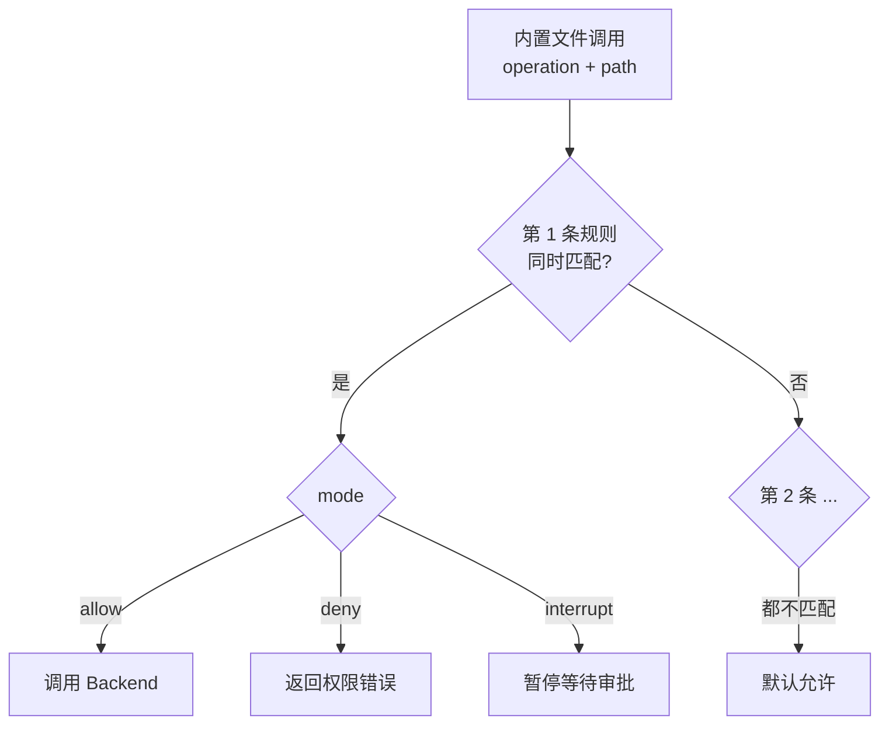

# 第 11 章：文件系统权限 — 用声明式规则控制 Agent 的读写边界

> 一句话总结：用 `FilesystemPermission` 把“能做什么操作、能碰哪些路径、哪些动作必须人工确认”写成可审查的声明式规则，并清楚它与自定义工具、MCP 和 `execute` 的边界差异。

## 1. 这一章解决什么问题

文件系统让 Agent 能把上下文写进文件，也把真实的副作用带进运行时。权限配置必须同时回答三件事：可以执行的操作、可以访问的路径、必须由人确认的动作。

`create_deep_agent()` 通过 `FilesystemMiddleware` 注入内置文件工具；传入 `permissions=` 后，中间件在调用 Backend **之前**检查每次文件操作。两个操作组覆盖的工具是：

| 操作组 | 覆盖工具 | 典型副作用 |
|---|---|---|
| `read` | `ls`、`read_file`、`glob`、`grep` | 暴露文件名、目录结构或内容 |
| `write` | `write_file`、`edit_file`、`delete` | 新建、修改或删除文件 |

v0.7 的 `write_file` 可以完整覆盖已有文件，所以 `write` 组同时保护“创建”和“整文件覆盖”。删除目录采用全有或全无：目录内只要有不被允许删除的后代，整次删除就应失败，不能留下部分结果。

版本门槛：`allow` / `deny` 需要 `deepagents>=0.5.2`，`interrupt` 需要 `deepagents>=0.6.8`；正文按 `deepagents==0.7.15` 核对。

## 2. 核心概念与机制

### 2.1 一条规则的三个字段

| 字段 | 取值 | 作用 |
|---|---|---|
| `operations` | `"read"`、`"write"` | 规则拦截哪类操作 |
| `paths` | Glob 路径列表 | 覆盖哪些虚拟路径 |
| `mode` | `"allow"`、`"deny"`、`"interrupt"` | 放行、拒绝或暂停等审批 |

路径支持 `**` 递归和 `{a,b}` 交替，例如 `paths=["/workspace/**", "/shared/{docs,templates}/**"]`。匹配的是 Agent 看到的**虚拟路径**，不一定等于宿主机真实路径：`FilesystemBackend(root_dir="/srv/project")` 会把 `/src/app.py` 映射到根目录下，但规则仍应围绕 Agent 文件空间设计。

### 2.2 求值模型：首条匹配生效



规则按声明顺序检查，**第一条同时匹配 `operations` 与 `paths` 的规则立即生效**，后续不再执行；没有任何规则匹配时**默认允许**。最后一点最容易误配：

```python
# 这不是白名单：工作区外没有命中任何规则，仍会放行
FilesystemPermission(operations=["read", "write"], paths=["/workspace/**"], mode="allow")
```

真正的白名单要在末尾追加全局拒绝，且顺序不能交换（否则 `/**` 先匹配，放行规则永远不执行）：

```python
workspace_only = [
    FilesystemPermission(operations=["read", "write"], paths=["/workspace/**"], mode="allow"),
    FilesystemPermission(operations=["read", "write"], paths=["/**"], mode="deny"),
]
```

若要保护敏感文件，必须把具体路径的 `deny` 放在目录 `allow` **之前**：`/workspace/private.txt` 同时属于工作区，顺序颠倒就会先命中 `allow`。稳定顺序是：**最具体的敏感路径 → 业务允许路径 → 最宽泛的兜底规则**。

### 2.3 四种常见策略

1. **整个文件系统只读**：`operations=["write"], paths=["/**"], mode="deny"`，适合审计、代码阅读、知识检索。
2. **只能访问指定工作区**：工作区 `allow` + 全局 `deny`，同时限制误写与越界读取。
3. **共享知识只读、用户记忆可写**：`CompositeBackend` 把 `/memories/` 路由到 `StoreBackend`，只对 `/policies/**` 写 `deny`；`/memories/**` 未受限，保持默认可读写。
4. **拒绝所有文件访问**：同时 `deny` 读写。注意它**不会从工具列表移除文件工具**，只是让命中的调用返回权限错误；若想减少无效选择，还要审视工具与 Middleware 组合。

### 2.4 `interrupt`：敏感写入交人审批

`mode="interrupt"` 不立即放行或拒绝，而是触发与工具审批相同的 HITL 中断。它需要 checkpointer 保存暂停状态，恢复时使用相同 `thread_id`。审查方可返回 `approve`、`edit` 或 `reject`；权限中断还会与 `interrupt_on=` 的自定义工具审批合并，可用同一套恢复协议处理。

路径模式要有明确锚点，优先 `/secrets/**` 或 `/projects/*/secrets/**`。`ls`、`glob`、`grep` 以及目录 `delete` 等批量操作需要判断整个搜索子树是否可能碰到受保护路径；完全不锚定的 `/**/secrets` 会导致保守的过度中断。

### 2.5 子 Agent：默认继承，显式配置则整体替换

子 Agent 默认继承主 Agent 的权限。只要在 spec 中提供 `permissions`，这组规则就**完整替换**父规则，而不是追加或取交集。因此子 Agent 的规则必须独立闭合——不要只写“额外拒绝写入”，却忘了带上工作区的读取边界。

### 2.6 与沙箱、CompositeBackend 的交界

- 当 `CompositeBackend` 的默认 Backend 是沙箱时，权限路径必须落在**已知的非沙箱路由前缀**下。只保护 `/memories/**` 有效；改成 `/workspace/**` 或 `/**` 会覆盖沙箱默认路由，`create_deep_agent()` 抛出 `NotImplementedError`，因为任意命令执行无法用文件路径规则建立真实边界。
- 在锁定版本中，把权限规则直接用于支持 `execute` 的 Backend 通常也会在构造时抛 `NotImplementedError`；`CompositeBackend` 中所有规则路径都以已配置路由前缀开头时这项检查有例外，但仍不保护 `execute`。
- `execute` 不受文件权限约束：即使 `write_file` 被拒绝，Shell 仍可写同一路径。二者是组合关系：权限管内置文件工具，沙箱管宿主隔离、网络、凭证与命令能力。

### 2.7 什么时候升级到自定义策略

声明式权限只回答“某类操作能否访问某个路径”。超出这两个维度时用 Policy Hook、`PolicyWrapper` 或自定义 Middleware。**Policy Hook 不是 `create_deep_agent(policy_hook=...)` 参数**，而是一种 Backend 扩展模式：

```text
内置文件工具
  -> FilesystemPermission：先检查 operation 与 path
  -> Policy Hook（GuardedBackend / PolicyWrapper）：再执行动态业务策略
  -> 实际存储 Backend
```

两种实现：继承具体 Backend（复用实现，但与类型绑定）；包装 `BackendProtocol`（可复用于 State/Store/Filesystem，但必须完整转发未拦截的方法）。判断条件适合频率、内容、调用身份、租户状态或审计等动态场景。

## 3. 代码与配置要点

最小只读配置：

```python
from deepagents import FilesystemPermission, create_deep_agent

agent = create_deep_agent(
    model=model,
    backend=backend,
    permissions=[
        FilesystemPermission(operations=["write"], paths=["/**"], mode="deny"),
    ],
)
```

`interrupt` 的暂停与恢复：

```python
from deepagents import FilesystemPermission, create_deep_agent
from langgraph.checkpoint.memory import InMemorySaver
from langgraph.types import Command

agent = create_deep_agent(
    model=model,
    permissions=[
        FilesystemPermission(operations=["write"], paths=["/secrets/**"], mode="interrupt"),
    ],
    checkpointer=InMemorySaver(),
)
config = {"configurable": {"thread_id": "permission-review-1"}}

result = agent.invoke({"messages": [{"role": "user", "content": "把临时凭证写入 /secrets/token.txt"}]},
                      config=config, version="v2")
if result.interrupts:
    request = result.interrupts[0].value["action_requests"][0]
    print(request["name"], request["args"])
    result = agent.invoke(
        Command(resume={"decisions": [{"type": "approve"}]}),
        config=config, version="v2",
    )
```

Policy Hook 的拒绝分支（节选，省略 `__init__` 与 `_denied`）：返回带 `error` 的结果对象，而不是抛异常或静默放行。

```python
class GuardedBackend(FilesystemBackend):
    def write(self, file_path: str, content: str) -> WriteResult:
        if self._denied(file_path):
            return WriteResult(error=f"Writes are not allowed under {file_path}")
        return super().write(file_path, content)
```

包装器有两个易踩的坑：`CompositeBackend` 会先剥离路由前缀，`routes={"/skills/": PolicyWrapper(...)}` 内部看到的是 `/test-skill/SKILL.md`，`deny_prefixes=["/skills/"]` 不会命中；`GuardedBackend` 继承了真实 `delete()`，删除会绕过示例策略，而 `PolicyWrapper` 继承的默认 `delete()` 抛 `NotImplementedError`。需要删除或上传时必须显式实现，并检查受保护后代。

## 4. 实验观察（若有 notebook）

Notebook 在自动清理的教学临时目录中运行，`FilesystemBackend(root_dir=..., virtual_mode=True)` 把 `/workspace/notes.txt` 等虚拟路径映射到临时目录；默认 offline，无需 Key、Docker 或数据库。运行环境为 `deepagents==0.7.22`（正文按 0.7.15 核对）。

| 实验 | 实际现象 |
|---|---|
| 全局只读 | 读取 `success`；写入 `status="error"`，文本 `Error: permission denied for write on /workspace/notes.txt`；文件仍为“原始笔记” |
| 只有工作区 `allow` | 写 `/outside.txt` 仍 `success`，内容被改写——证明 `allow` 不构成白名单 |
| `allow` + 全局 `deny` | 工作区写成功；工作区外 `permission denied` |
| 交换顺序（`deny` 在前） | 连工作区写入也被拒绝 |
| 私有文件 deny 顺序 | 先 deny 则读取 `error`；目录 allow 在前则读到“仅用于演示的私有资料” |
| `interrupt` 审批 | 暂停时 `interrupts` 长度为 1、无任何 `ToolMessage`、文件仍是旧报告；`approve` 后出现关联调用 ID 的成功结果，文件逐字等于实际批准内容 |
| 审批场景写错路径 | 把 `/review/report.txt` 写成 `/report/report.txt`，被兜底 `deny` 拒绝，不产生审批也不改文件 |

最后一行来自真实模型复测的教训：只有 `/review/**` 的 `interrupt` 规则时，错误路径不匹配任何规则，按“未匹配默认允许”会在无审批下改写报告。Notebook 因此补了全局兜底拒绝，并用 `LimitVisibleTools` 收窄模型可见工具（不改变权限判断）。

注意 Notebook 的 live 记录仍为**待验证**（2026-10-06 核对），尚无整本 live 通过记录；它只演示单文件 `read_file` / `write_file`，不覆盖目录删除、批量搜索、子 Agent 继承或 `CompositeBackend` 路由。

## 5. 常见误区

- **以为写了 `allow /workspace/**` 就是白名单**：未匹配路径默认允许，必须补末尾全局 `deny`。
- **把全局 `deny` 放在最前**：first-match-wins 会连工作区一起拒绝。
- **先放行目录再拒绝私有文件**：具体路径的 `deny` 必须在前。
- **以为 `FilesystemPermission` 能保护一切入口**：自定义 LangChain 工具、MCP 文件工具、`execute` 都不经过这道门。
- **以为 `deny_all` 会移除文件工具**：工具仍在，只是调用返回权限错误。
- **自定义 `FilesystemMiddleware` 后以为顶层 `permissions=` 会合并**：v0.7 允许同名 Middleware 原位置换，新实例会整体替换默认实例，升级后要用真实允许/拒绝/覆盖写入/删除调用做回归。
- **以为子 Agent 的 `permissions` 是追加**：它是整体替换，必须独立闭合。
- **对沙箱默认路由写 `/**` 规则**：会触发 `NotImplementedError`，因为路径规则无法约束任意命令执行。
- **把 Policy Hook 当成构造参数**：它是 Backend 扩展模式，需自己继承或包装。
- **只测“允许路径能成功”**：还必须测陌生路径、敏感读取、覆盖写入、目录删除、`truncated=True` 与 `interrupt` 三种决策。

## 6. 自测清单

- [ ] 能说出 `read` / `write` 两组分别覆盖哪些内置工具，以及为什么 `write_file` 的整文件覆盖也受 `write` 保护。
- [ ] 能手写一份“工作区白名单”，并解释两条规则的顺序为什么不能交换。
- [ ] 能说明 `interrupt` 需要哪些前置条件（checkpointer、相同 `thread_id`）；`version="v2"` 只是示例用来读取 `result.interrupts` / `result.value` 的返回格式，不是启用 HITL 的前提，并能写出恢复时的 `Command(resume=...)` 结构。
- [ ] 能指出 `FilesystemPermission` 覆盖不到的三类入口，并各给一种补偿控制。
- [ ] 能解释 `CompositeBackend` 路由前缀剥离对 `PolicyWrapper` 的影响，以及为何沙箱默认路由不能配 `/**` 权限。
