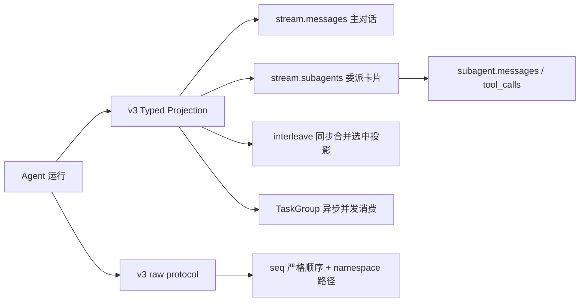

# 第 14 章：Streaming — 实时观察主 Agent、子 Agent 与工具调用

> 一句话总结：用 `stream_events(version="v3")` 的 Typed Projection 把一次长运行拆成消息、委派、工具调用与原始协议事件四条可订阅的观察通道，让界面在最终答案出现前就能回答“谁在工作、做到哪一步”。

## 1. 这一章解决什么问题

研究助手运行了两分钟，后台日志显示它调用了搜索工具并启动了 `researcher`，页面却只有一个转圈图标。原因不是模型，而是 `invoke()` 的返回粒度：它只在整次运行结束后返回最终状态，页面无法回答 coordinator 是否真的委派、子 Agent 在搜索还是已失败、工具参数是否还在生成、最终答案之前有哪些步骤。

改造按故障逐步推进：先让用户看见委派，再看见子 Agent 的消息与工具调用，随后修复事件交错导致的顺序问题，最后解释旧代码里的 `type`/`ns`/`data` 协议。为了让案例稳定复现，示例用一个系统提示要求 coordinator 把每次研究请求都交给 `researcher`；但提示词不能强制模型遵守，模型本身还必须支持 Tool Calling 才能产生 `task` 调用。真实研究还需要另行实现并注册搜索工具。

## 2. 核心概念与机制

### 2.1 三层观察接口，解决不同问题

| 层级 | API | 面向 | 主要字段 |
| --- | --- | --- | --- |
| v3 Typed Projection | `agent.stream_events(request, version="v3")` | 产品界面 | `messages`、`tool_calls`、`subagents`、`values`、`output` |
| v3 raw protocol | 直接迭代同一个流对象 | 审计、重放、查漏 | `seq`、`method`、`params.namespace`、`params.data` |
| v2 StreamPart | `agent.stream(..., version="v2")` | 图执行调试、旧应用迁移 | `type`、`ns`、`data` |

新应用优先 v3；v2 用于理解 LangGraph 协议和 custom updates。两套循环不要混在同一个消费者里。

### 2.2 委派是一个带生命周期的 handle

`stream.subagents` 的每个 handle 对应一次 `task` 委派，包含 `name`、`path`、`status`，以及按需打开的 `messages`、`tool_calls`、`values`、`subagents`、`output`。

关键区分：

- `name` 来自 coordinator 为 `task` 选择的 `subagent_type`，不是图节点名，也不是唯一 ID；同一个 `researcher` 可以被调用多次。
- `path` 是本次委派在 Agent 树中的 namespace 路径，是当前运行内 UI 卡片的唯一键。
- `status` 是生命周期，不是质量结论：`started` → 建卡；`completed` → 读 `output`；`failed` → 保存异常；`interrupted` → 保留状态等待恢复。`completed` 只代表这次委派正常结束，内容正确性仍要靠测试、Rubric 或人工审核。

### 2.3 `path`、`namespace`、`ns` 是同一概念的不同投影

路径每段形如 `<node_name>:<runtime_or_task_id>`。一级子 Agent 通过 `task` 启动时，`subagent.path` 通常只有一个 `tools:<id>` 段；`tools` 是承载委派的图节点，`<id>` 区分本次执行，不是显示名。

```text
根 Agent 的 v2 ns              ()
根 Agent 的 v3 raw namespace   []
一级子 Agent 的 path            ("tools:abc123",)
子 Agent 内部模型事件的 v2 ns   ("tools:abc123", "model_request:def456")
```

因此子 Agent 根级事件的 namespace 归一化后通常等于 `subagent.path`，更深层事件以它为前缀：

```python
def belongs_to_subagent(namespace: list[str] | tuple[str, ...], path: tuple[str, ...]) -> bool:
    return tuple(namespace[: len(path)]) == path
```

不要要求子 Agent 内每个事件都与根 `path` 完全相等，也不要用 `name` 代替路径。

### 2.4 Projection 是“订阅才有时”的，不是可回读的日志

在本章核对的版本（`deepagents==0.7.15` / `langgraph==1.2.11`）中，`messages`、`tool_calls`、`subagents` 等图级通道按订阅消费：只有订阅后的事件才进入消费者缓冲。仅访问 `subagent.messages` 属性不等于订阅；同步代码要通过 `iter(...)`、`for` 或 `interleave(...)` 订阅。

这解释了一个致命反例：先读 `stream.output` 推动整张图跑完，再订阅 `stream.subagents`，可能一个委派 handle 都收不到。要观察的 projection 必须在事件到达前订阅。父级与子级也是独立通道：`stream.messages` 只含 coordinator 的消息，不会替应用合并所有子 Agent 消息。

`values` 是当前 Agent state 的快照，不是可追加的增量，也没有框架统一规定的业务字段；它适合调试和状态面板，主对话文本仍从 `messages` 读。v0.7 默认不再启用 Todo，若前端依赖 `todos`，需在 Agent 端显式传入 `TodoListMiddleware`。

### 2.5 顺序问题有三种解法



1. 异步服务：用 `asyncio.TaskGroup` 同时消费主投影和每个子 Agent 的投影，发现新子 Agent 立即注册，避免一个迭代器阻塞其他来源。并发解决阻塞，但不产生带全局序号的合并流。
2. 同步程序：`interleave` 按严格到达顺序合并显式选中的 projection，返回 `(name, item)`。它只合并传入的投影；读取 `item.text` 完整值或进入子循环仍可能阻塞外层。
3. 审计/重放：读 raw event 的 `seq`，这是唯一严格递增的运行内序号；`timestamp` 只适合展示，不保证排序。

### 2.6 四个生产运行边界

1. **Streaming 不等于并行。** 是否并行取决于编排方式，不能从“事件交错”反推执行模型。
2. **客户端断开。** 长任务需要明确选择超时、取消，还是转入后台继续执行。
3. **慢客户端。** 服务端要限制队列大小，或丢弃能够重建的增量，不能无限积压。
4. **刷新与重放。** 需要重放时，把标准化事件写入 Trace、数据库或对象存储；内存 iterator 不是持久化日志。

工具错误、子 Agent 失败和中断状态都要原样保留；只有把失败也做成事件，用户才能区分“研究没有完成”和“页面没有刷新”。

## 3. 代码与配置要点

### 3.1 先显示“研究助手已启动”

```python
stream = agent.stream_events(request, version="v3")

for subagent in stream.subagents:
    print(f"[{subagent.name}] {subagent.status}")
    print("path:", subagent.path)
    try:
        print("output:", subagent.output)
    except Exception as exc:
        print(f"failed: {exc}")
```

这里的异常要变成卡片上的错误，而不是被吞掉。产品界面不要从 `model_request`、`tools` 这类内部节点名猜状态。

### 3.2 同时看主消息与子 Agent 消息

```python
with agent.stream_events(request, version="v3") as stream:
    for kind, item in stream.interleave("messages", "subagents"):
        if kind == "messages":
            print("[coordinator]", str(item.text))
        else:
            for message in item.messages:
                print(f"[{item.name}]", str(message.text))
```

`str(message.text)` 会等待当前消息完整到达，因此该同步示例不能保证实时展示所有交错增量。若先耗尽主消息流、再晚订阅子 Agent，在当前版本可能直接漏掉 handle。官方 message handle 没有 `source` 或 `kind` 字段；那是 `deepagents/streaming` 模板的 `event_adapter.py` 在转成 SSE 事件时写入的应用字段。

### 3.3 工具调用要分三支判断

```python
for kind, item in stream.interleave("tool_calls", "subagents"):
    if kind == "tool_calls":
        calls.append(("coordinator", item))
    else:
        for call in item.tool_calls:
            calls.append((item.name, call))

final_state = stream.output
for source, call in calls:
    if not call.completed:
        status = "running"
    elif call.error is not None:
        status = "failed"
    else:
        status = "completed"
```

`output_deltas` 是执行过程中的增量，适合实时日志；`output` 是成功后的最终结果，二者同时保存时要避免重复拼接。`input` 可能含敏感数据，写日志前要脱敏。

### 3.4 异步并发消费

```python
async with await agent.astream_events(request, version="v3") as stream:
    async with asyncio.TaskGroup() as group:
        def subscribe(scope, label):
            group.create_task(consume_messages(aiter(scope.messages), label))
            group.create_task(consume_subagents(aiter(scope.subagents)))

        async def consume_subagents(subagents):
            async for subagent in subagents:
                subscribe(subagent, f"{subagent.name}:{subagent.path}")

        subscribe(stream, "coordinator")
```

`TaskGroup` 在某个消费者失败时取消其余任务；流的异步上下文负责清理。此处按 delta 显示文本，而不是 `await message.text` 等整条消息。

### 3.5 旧代码的 v2 协议

```python
for chunk in agent.stream(
    request,
    stream_mode=["updates", "messages", "custom"],
    subgraphs=True,
    version="v2",
):
    print(chunk["type"], chunk["ns"], chunk["data"])
```

`ns == ()` 表示主 Agent，非空 tuple 是产生 chunk 的完整 namespace；`subgraphs=True` 才会让子图事件进入同一条流。`updates` 的 `data` 常是 `{node_name: state_update}`，`messages` 是 `(token, metadata)`，`custom` 是工具通过 `get_stream_writer()` 写入的任意对象。嵌套子 Agent 可能出现多个 `tools:` 段，不能只取第一个 ID 当全局唯一键。

### 3.6 自定义进度

```python
@tool
def analyze_data(topic: str) -> str:
    writer = get_stream_writer()
    writer({"status": "starting", "topic": topic, "progress": 0})
    writer({"status": "complete", "topic": topic, "progress": 100})
    return f"Analysis complete: {topic}"
```

`status`、`topic`、`progress` 全是应用自己的 schema，不是框架固定字段。生产事件应加 `schema_version`，未知版本要记录并降级。模板事件里的 `kind`、`source`、`path`、`phase` 属于应用适配层；`seq`、`method`、`params` 才属于 raw protocol。模板没有 `run_id`，只有可选的 `thread_id` 用于会话连续性。

## 4. 实验观察（若有 notebook）

**配套 notebook：** `notebooks/ch14/01-streaming-projections.md`，为 **offline** 模式，用公共 `ScriptedChatModel` 安排模型响应，不需要 Key，图和工具真实执行；锁定 `deepagents==0.7.22`、`langchain==1.4.3`、`langgraph==1.2.13`（与正文核对版本不同，notebook 以 `uv.lock` 为准）。

真实输出要点：

- 主 Agent 发出一次 `task`，参数为 `{"subagent_type": "researcher", "description": ...}`；子 Agent 发出一次 `inspect_notes`，参数 `{"topic": "streaming"}`；工具读到 3 条笔记。
- 委派 `path` 形如 `('tools:a87e5d9c-3f46-8a11-70d0-d581c9ad3706',)`。这是 tuple，重跑时动态 ID 会变，不能跨运行逐字比较。
- 自定义进度必须注册 `CustomTransformer`，并从 `child.custom` 读取；根 `run.custom` 的作用域是根图，不会自动汇集子图进度。输出顺序为 `{'phase': 'starting', ...}` → `{'phase': 'complete', ...}`。
- raw 运行共 20 个事件：`values` 8、`messages` 4、`tools` 4、`lifecycle` 2、`custom` 2。`seq` 严格递增；过滤后不必连续。可见顺序为 `#04` 主 Agent `tool-started` → `#09` researcher `tool-started` → `#10/#11` 两条 custom → `#12` `tool-finished` → `#16` 主 Agent `tool-finished`。
- 晚订阅反例：实际子 Agent 工具执行 1 次，但先读 `late_run.output` 再订阅 `late_run.subagents`，收到的 handle 数为 0。任务不是没执行，而是消费者错过了事件窗口。
- offline 脚本模型不做 token 分块，raw `messages` 是完整的 `(AIMessage, metadata)`，共 4 条完整消息而不是 token 数。因此不能写只接受 `content-block-delta`/`text-delta` 的过滤器，再把空结果当成“没有模型输出”。
- `with` 退出会调用流的 `abort()`；`config={"recursion_limit": 16}` 只是图执行步数上限，不是费用或所有嵌套调用的资源上限。
- notebook 明确未验证：逐 token 传输、异步并发消费、工具异常/子 Agent 失败的独立触发、v2 迁移、SSE 页面、断连背压与持久化重放。

## 5. 常见误区

1. **把 `completed` 当成功**：它只表示委派结束，仍要检查 `output`、`error` 和业务内容。
2. **用 `name` 当唯一键**：同名 `researcher` 可被多次委派，必须用 `path` 路由卡片。
3. **以为访问属性就算订阅**：不迭代、不 `interleave`，projection 不会为这个消费者缓冲。
4. **先读 `output` 再订阅**：图已跑完，子 Agent handle 会永久错过。
5. **把 `interleave` 当全局时间线**：它只合并显式选中的 handle 到达顺序，读取完整文本还会阻塞。
6. **把 `values` 当增量追加**：它是状态快照，应按路径覆盖最新值。
7. **混用 v3 与 v2 字段**：`message.text` 不能直接套到 v2 的 `(token, metadata)` 上。
8. **把模板字段当框架字段**：`kind`、`source`、`phase` 是应用 adapter 生成的；`run_id` 并不存在。

## 6. 自测清单

- [ ] 能说出 `subagent.name`、`subagent.path` 与 raw `params.namespace` 三者的来源和用途差异。
- [ ] 能在不读 `output` 的前提下订阅 `subagents`，并解释为什么顺序不能反过来。
- [ ] 能写出工具调用的三分支状态判断，而不是 `if call.completed: success`。
- [ ] 能说明 `interleave` 与 `TaskGroup` 各自解决什么问题、又各自不保证什么。
- [ ] 能为自己的页面列出断连、慢客户端、超时取消和重放四个运行边界。
