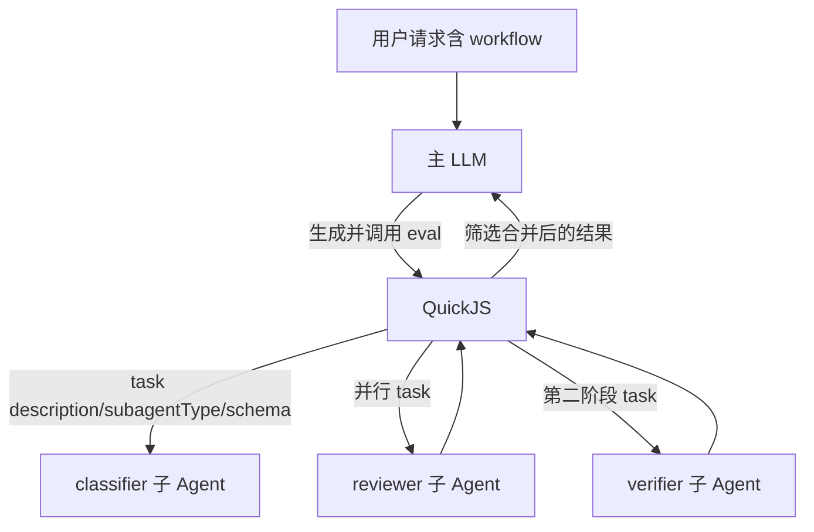

# 第 16 章：Dynamic Subagents — 用代码编排多个 Agent

> 一句话总结：沿用 QuickJS Interpreter，把子 Agent 变成 JavaScript 里的全局函数 `task()`，让模型生成的编排代码负责批量扇出、分类路由、交叉复核和循环收敛，而不是让主模型逐次决定下一次委派。

## 1. 这一章解决什么问题

一个代码仓库有 24 个路由文件。主 Agent 可以把第一个文件交给审查 Agent，等结果回来再决定是否看第二个；也可以先列出全部文件，用 JavaScript 一次组织 24 次审查，再把可疑发现交给另一个 Agent 复核。两种方式都用了子 Agent，差别在于谁控制任务拆分、并发和下一阶段。

普通 `task` Tool 适合一次明确委派：主 Agent 为每次调用决定 `description` 和 `subagent_type`，拿到结果后继续自己的推理循环。任务覆盖许多独立对象，或需要分类、并行、交叉验证和反复收敛时，逐次委派会带来漏项、额外模型轮次和不稳定的控制流。Dynamic Subagents 把编排位置从“模型逐轮决策”移到“一次 `eval` 中的 JavaScript”。

| 任务形状 | 优先方式 | 原因 |
| --- | --- | --- |
| 把一个明确问题交给一个专家 | 普通 `task` Tool | 路径短，易观察、易逐次审批 |
| 对一批独立对象执行同类分析 | Dynamic Subagents | JavaScript 可完整覆盖输入并并行扇出 |
| 输入混杂，需要先分类再分发 | Dynamic Subagents | 分类结果可直接决定下一批 `subagentType` |
| 同一发现需要独立复核 | Dynamic Subagents | 第一阶段输出可在代码中进入第二阶段 |
| 范围未知，需反复搜索直到没有新结果 | Dynamic Subagents | 循环与停止条件由代码明确表达 |
| 子任务要在后台持续运行、主 Agent 随后查询 | Async Subagents | 生命周期目标不同，不是并行扇出 |

Dynamic Subagents 不是新的子 Agent 类型，它改变的是编排位置。代码编排能让以下规则显式落地：

1. 每个输入都进入一次审查。
2. 独立任务按批次并行运行。
3. 第一阶段发现统一去重和筛选。
4. 只有高风险发现进入复核。
5. 最终只把已确认结果交还主模型。

但生成代码通过检查，只保证控制流和覆盖规则被写清楚，不保证每个子任务成功，也不保证子 Agent 的判断正确。每次 `task()` 都会启动完整的 Agent 推理循环，结果仍受模型、Prompt、工具和输入影响。

## 2. 核心概念与机制

### 2.1 运行链路：AI 写 JavaScript，运行时执行调度

当 Agent 同时配置了子 Agent 和 Interpreter 中间件，JavaScript 环境会出现全局函数 `task()`：



1. 主 LLM 读取请求，决定是否调用 `eval`，并为当前任务编写 JavaScript。
2. JavaScript 在 QuickJS 中运行，遇到 `task()` 时启动指定子 Agent。
3. 每个子 Agent 运行自己的完整推理循环，可使用分配给它的工具。
4. JavaScript 收集、筛选、合并结果，只把需要的信息交回主 LLM。

所以 `task()` 不是开发者在 Python 里手写的固定工作流函数，而是 Interpreter 注入到 JavaScript 环境的全局函数；调用它的代码通常由主 LLM 现场生成。这对模型提出更高要求：既要稳定调用工具，也要写出可运行的异步 JavaScript，正确使用 `await`、数组方法、循环、分支和 Schema，还要选中真实存在的 `subagentType`。能力不足时常见语法错误、角色名漂移、遗漏输入或循环失控。

提示词里的 `workflow` 只是提醒主 LLM 优先考虑代码编排，不是 API 参数。真正提供能力的是 `subagents` 配置和 `CodeInterpreterMiddleware`。

### 2.2 `task()` 的调用契约只有三个字段

| 字段 | 是否必填 | 作用 |
| --- | --- | --- |
| `description` | 是 | 发给子 Agent 的任务说明，应包含目标、范围、约束和输出要求 |
| `subagentType` | 是 | 选择哪个已配置子 Agent，值必须匹配 `subagents` 中的 `name` |
| `responseSchema` | 否 | 用 JSON Schema 约束返回值；设置后得到的已经是 JavaScript 对象 |

```typescript
const review = await task({
  description: "读取 src/auth/login.ts，检查认证绕过；引用行号。",
  subagentType: "reviewer",
  responseSchema: {
    type: "object",
    properties: {
      issues: {
        type: "array",
        items: {
          type: "object",
          properties: {
            line: { type: "number" },
            severity: { type: "string" },
            evidence: { type: "string" },
          },
          required: ["line", "severity", "evidence"],
        },
      },
    },
    required: ["issues"],
  },
});

const highRisk = review.issues.filter((item) => item.severity === "high");
```

设置 `responseSchema` 后不需要 `JSON.parse`。一次 `task()` 返回的是本次子 Agent 运行的结果，不是可继续对话的会话；下一次调度仍要提供自包含的 `description`。Schema 只保证返回形状可组合，不保证结论正确；汇总时仍要保留来源文件、行号、证据、复核状态和稳定 ID，便于去重与回查。

### 2.3 角色由开发者准备，流程由用户描述

开发者负责两层输入：

- `subagents` 中的 `name` 是 JavaScript 里 `subagentType` 的可用值；
- `description` 帮助主 LLM 选角色；
- `system_prompt` 约束该角色怎样完成任务。

用户则在请求中用 `workflow` 写清流程。一个可检查的流程提示包含四部分：

1. 用 `workflow` 明确提示采用工作流式编排。
2. 给出明确的输入范围和可用角色。
3. 说明先做什么、后做什么，哪些步骤可以并行。
4. 写清去重、数量上限、停止条件和最终返回内容。

```text
运行一个 workflow，处理以下范围：[明确的输入范围]。
先让 [角色 A] 完成 [第一步]，再让 [角色 B] 根据第一步结果完成 [第二步]。
每个输入都要 [覆盖、去重或限制数量]；遇到 [异常或停止条件] 时 [处理方式]。
最后返回 [结果字段和未处理信息]。
```

骨架描述业务流程，不规定底层函数写法。主 LLM 可能选择并发、循环、分支或结构化返回；能否生成正确代码，仍取决于模型的代码生成与工具调用能力。

### 2.4 三种可复用的编排形态

**分类后分流**：先让 `classifier` 把工单归入受控类别，再由映射表选择 `bug-fixer`、`feature-analyst` 或 `support-agent`。检查三点：类别是否受 Schema 的 `enum` 限制、`unknown` 是否没有被强行路由、每条工单 ID 是否都出现在结果中。

**并行审查后复核**：`reviewer` 分别检查每个文件，候选结果带稳定 ID、文件、行号和证据；按稳定 ID 去重，再让 `verifier` 独立确认或反驳，最多复核 20 条。最终返回已确认、被反驳和未复核的数量。检查文件是否全部进入 reviewer、每条候选是否都有独立结论、超出上限的部分是否计入未复核。

**分轮搜索直到停止**：范围未知时，提示词同时给出业务停止条件和资源上限——“某一轮没有新增项就停止；最多 5 轮，每轮最多保留 20 项”。代码用 `Set` 去重、用 `fresh.length === 0` 触发业务停止、用 `round < 5` 限制资源。两者都应能从生成的 JavaScript 中直接看到。

三个示例都不是内置模式，也不是必须照抄的脚本；变量名、循环和并发写法可以不同，但输入覆盖、角色名、结果结构和停止条件必须与提示词一致。

### 2.5 中间件参数继续生效

Dynamic Subagents 没有另起执行环境，主 LLM 生成的 JavaScript 仍由 `CodeInterpreterMiddleware` 的 `eval` 执行。第 15 章的内存、超时、输出、状态、PTC 和子 Agent 开关都会继续约束动态编排。

正文给出一组偏保守的起点：

```python
middleware = CodeInterpreterMiddleware(
    mode="turn",
    subagents=True,
    memory_limit=64 * 1024 * 1024,
    timeout=30.0,
    capture_console=True,
    max_result_chars=8000,
    ptc=["glob"],
    max_ptc_calls=64,
    max_snapshot_bytes=64 * 1024 * 1024,
)
```

需要特别注意：

- `max_ptc_calls` 只限制 `tools.glob(...)`、`tools.webSearch(...)` 这类 PTC 调用，**不限制 `task()` 数量**；当前配置表里没有 `max_task_calls`。动态调度数量要靠输入批次、循环上限、Prompt 约束和业务预算控制。
- `timeout` 不包含等待异步 `task()` / PTC 宿主调用的时间，不是整个工作流的截止时间；子 Agent 的模型、网络工具和整次运行都要单独设置超时或取消策略。
- `mode` 只决定 JavaScript 状态保留到 `call`、`turn` 还是 `thread`，不改变子 Agent 本身的会话语义。
- `max_result_chars` 截断返回给主 LLM 的结果；汇总过长会直接影响后续判断，应先在 JavaScript 内聚合。
- `max_snapshot_bytes` 未设置时使用 `memory_limit`，超限快照不会继续保留。
- 代码审查需要能读取目标仓库的 Backend；默认 StateBackend 不会自动看到本机仓库。

### 2.6 审批边界

`task()` 在已经进入的 `eval` 内直接调度子 Agent，**不会逐次触发父 Agent 的 `interrupt_on["task"]` 审批**。需要审批整段编排时，对 `eval` 设置审批；子 Agent 内的敏感工具应在其自身配置审批。若业务要求父级逐次批准委派，应设置 `CodeInterpreterMiddleware(subagents=False)`，保留普通 `task` Tool 路径。这个开关不等于禁用 Agent 的普通委派工具。

## 3. 代码与配置要点

### 3.1 定义角色

```python
subagents = [
    {
        "name": "classifier",
        "description": "将工单归为 bug、feature、question 或 unknown",
        "system_prompt": "只负责分类；信息不足时返回 unknown，不处理工单。",
    },
    {
        "name": "reviewer",
        "description": "审查代码并给出文件、行号和证据",
        "system_prompt": "只报告有代码证据的候选问题；稳定 ID 使用‘文件:行号:问题类型’。",
    },
    {
        "name": "verifier",
        "description": "独立复核候选问题并优先识别误报",
        "system_prompt": "重新读取代码，寻找反证后再确认或反驳。",
    },
    {
        "name": "analyzer",
        "description": "在给定范围内分轮查找死代码",
        "system_prompt": "用文件和符号组成稳定 ID，不要重复已发现项。",
    },
]
```

正文完整示例还有 `bug-fixer`、`feature-analyst`、`support-agent` 三个角色，共七个。

### 3.2 接入 Agent

```python
from deepagents import create_deep_agent
from langchain_quickjs import CodeInterpreterMiddleware

agent = create_deep_agent(
    model=model,
    subagents=subagents,
    middleware=[CodeInterpreterMiddleware(mode="turn")],
)
```

配置完成后，主 LLM 才能选择这些角色。正文在 `deepagents==0.7.8`、`langchain-quickjs==0.3.5` 中核对；该能力仍为 Beta，接口可能变化。

### 3.3 分类路由的核心片段

```typescript
const handler = {
  bug: "bug-fixer",
  feature: "feature-analyst",
  question: "support-agent",
};
const results = await Promise.all(tickets.map(async (ticket) => {
  const { category } = await task({
    description: `只对工单分类：${ticket.id}\n${ticket.text}`,
    subagentType: "classifier",
    responseSchema: categorySchema,
  });
  if (!handler[category]) {
    return { id: ticket.id, category, unhandledReason: "分类为 unknown" };
  }
  const result = await task({
    description: `处理工单 ${ticket.id}：${ticket.text}`,
    subagentType: handler[category],
  });
  return { id: ticket.id, category, result };
}));
results;
```

`categorySchema` 应把 `category` 限制为 `["bug", "feature", "question", "unknown"]`，否则映射表之外的类别会破坏分支。

### 3.4 迭代停止的核心片段

```typescript
const seen = new Set();
const found = [];
let rounds = 0;
let stopReason = "达到 5 轮上限";
for (let round = 0; round < 5; round += 1) {
  rounds = round + 1;
  const { items } = await task({
    description: `在 src/legacy/ 中继续查找死代码，每轮最多返回 20 项。已发现：${[...seen].join(", ") || "无"}`,
    subagentType: "analyzer",
    responseSchema: itemsSchema,
  });
  const uniqueItems = [...new Map(items.map((item) => [item.id, item])).values()];
  const fresh = uniqueItems.filter((item) => !seen.has(item.id)).slice(0, 20);
  if (fresh.length === 0) {
    stopReason = "本轮没有新增项";
    break;
  }
  for (const item of fresh) { seen.add(item.id); found.push(item); }
}
({ rounds, stopReason, found });
```

每次传给 `analyzer` 的 `description` 都带上已发现 ID，避免重复；`fresh.length === 0` 是业务停止，`round < 5` 是资源上限。

## 4. 实验观察（若有 notebook）

本章无配套 notebook。正文示例 JavaScript 只是“可能生成”的写法，不是固定输出；以下建议用于把这种不确定性纳入工程控制。

### 实践建议

1. **先给明确输入清单。** 第一版把 24 个文件路径或工单 ID 写进提示词，不让模型猜范围；可控后再尝试自行扩展。
2. **先出草案再执行。** 需要运行前审查时，要求只输出 JavaScript，或对 `eval` 设审批；不要等子 Agent 批量跑完再检查。
3. **核对覆盖、角色和停止条件。** 每个输入恰好处理一次，`subagentType` 来自已配置 `name`；业务停止（无新增）与资源上限（5 轮、每轮 20 项）都要能从代码读到。
4. **用稳定 ID 支撑去重与复核。** 让 reviewer/analyzer 输出“文件:行号:问题类型”，verifier 再独立读代码寻找反证。
5. **审计、分批与兜底。** 记录 `eval` 输入与每次 `task()` 摘要；先用 3 个文件再扩到 24 个；为子 Agent 模型、网络工具和整次运行分别设超时。

## 5. 常见误区

1. **把 Dynamic Subagents 当成新子 Agent 类型。** 它只是把 `task` 的调用位置从模型转移到 JavaScript。
2. **把 `workflow` 当 API 开关。** 它只是提示信号，能力来自 `subagents` 与中间件配置。
3. **以为 `responseSchema` 能保证判断正确。** 它只约束返回形状。
4. **以为 `max_ptc_calls` 能限制子 Agent 数量。** 它只限制 `tools.*`，`task()` 没有对应的 `max_task_calls`。
5. **以为 `timeout=30.0` 能保证 30 秒结束整次审查。** 异步宿主等待不计入。
6. **以为 `task()` 会逐次触发 `interrupt_on["task"]`。** 需要在 `eval` 层审批，或设 `subagents=False` 回到普通委派。

## 6. 自测清单

- [ ] 能说清普通 `task` Tool 与 JavaScript `task()` 在控制流、并发和审批上的差异。
- [ ] 能写出 `task()` 的三个字段，并说明 `responseSchema` 设置后为什么不需要 `JSON.parse`。
- [ ] 能为一批异构工单设计“分类 → 路由 → 汇总”的提示词与 JavaScript。
- [ ] 能指出 `max_ptc_calls`、`timeout`、`max_result_chars` 各自约束什么、不约束什么。
- [ ] 能说明 `subagents=False` 何时使用，以及它为什么不是禁用普通委派工具。
