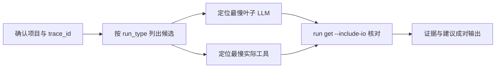

# AgentSeek 准备篇（下）：为 AI 编码助手安装开发技能

> 一句话总结：用 Skills CLI 把 `langchain-dev-guide` 和 `langsmith-trace` 装进当前项目，让 Codex、Claude Code 等助手能查 LangChain 生态资料，并按固定流程从 Trace 中找出真正的模型与工具瓶颈。

## 1. 这一章解决什么问题

后续章节要不断修改研究应用、解释运行结果，但通用编码助手不知道本课程的模型配置惯例，也不知道如何系统地读 LangSmith Trace。直接问“为什么慢”，得到的往往是猜测。

本章补两块能力：一块领域知识（`langchain-dev-guide`），一块查询流程（`langsmith-trace`）。同时划清一个容易混淆的边界：这里装的是**给编码助手用的开发技能**，不是给 Deep Agent 运行时加载的 Skill。

## 2. 核心概念与机制

两类 Skill 共用 `SKILL.md` 形式，但服务对象、安装方式完全不同：

| 类型 | 使用者 | 安装/加载方式 | 章节 |
|---|---|---|---|
| 编码助手开发技能 | Codex、Claude Code、Cursor | `npx skills add ...` | 本章 |
| DeepAgents 运行时 Skill | 你构建的 Deep Agent | `create_deep_agent(skills=[...])` | 第 7 章 |

安装范围也有两套：项目级是默认行为，写入项目目录，便于审查和纳入版本管理；`--global` 写入用户目录，适合个人长期使用。二者不会自动合并，`npx skills list` 默认只列项目级，查全局要加 `--global`。

技能的工作方式也不是“把全部资料塞进上下文”。编码助手先读取 `SKILL.md` 这个入口，再按任务需要读取它引用的参考文件。因此判断技能是否生效，不能只看回答是否流畅，而要看助手能否说出它读了哪个文件、依据哪条规则。`langchain-dev-guide` 覆盖 DeepAgents 的模型、文件系统、子 Agent、长期记忆，OpenAI 兼容接口接入，Middleware 与多 Agent 编排，以及结构化输出、Tool Call 和运行时上下文问题；这些正是后续改项目时容易踩的坑。

目录映射按助手区分：

| 助手 | 项目级 | 全局 |
|---|---|---|
| Codex | `.agents/skills/` | `~/.agents/skills/` |
| Claude Code | `.claude/skills/` | `~/.claude/skills/` |
| Cursor | `.agents/skills/` | `~/.cursor/skills/` |

`langsmith-trace` 的价值不在“能列 Trace”，而在**分层归因**。一次研究 Trace 里有根 `research`、`research-agent` 子 Agent、`ChatOpenAI` 模型调用、`tavily_search` 工具调用，还有多层 middleware 包装。包装节点的耗时来自子节点汇总，把它当瓶颈会得出错误结论。正确顺序是：确认项目和 `trace_id` → 按 `run_type` 缩小范围 → 对候选叶子 Run 看输入输出 → 输出带证据的表格。



章节给出的实测基线：162 个 Run、0 个错误、总耗时约 472.9 秒；22 个模型 Run 中最慢叶子 `ChatOpenAI` 约 85.9 秒；17 个工具 Run 中排除 `task` 包装后，最慢实际工具是约 25.1 秒的 `tavily_search`。这些是单次样本，不是固定预期。

## 3. 代码与配置要点

先确认 Node/npm，再查看仓库提供的技能：

```bash
node --version
npm --version
npx skills add ob-labs/agentseek --list
```

项目级安装，并指定编码助手：

```bash
npx skills add ob-labs/agentseek --skill langchain-dev-guide --skill langsmith-trace
npx skills add ob-labs/agentseek --skill langchain-dev-guide --skill langsmith-trace --agent codex --yes
npx skills add ob-labs/agentseek --skill langchain-dev-guide --skill langsmith-trace --agent claude-code --yes
```

核对落点：

```bash
npx skills list
ls .agents/skills/langchain-dev-guide/SKILL.md
ls .agents/skills/langsmith-trace/SKILL.md
```

LangSmith CLI 必须用官方安装脚本，不能用 Python 包替代：

```bash
curl -fsSL https://cli.langsmith.com/install.sh | sh    # macOS / Linux / WSL2
```

```powershell
irm https://cli.langsmith.com/install.ps1 | iex          # 原生 Windows
```

加载 `.env` 后查询；凭证只从环境变量读取，不要用 `--api-key`：

```bash
set -a; source .env; set +a
langsmith --format pretty project list
langsmith trace list --project deepagents-course --name research --include-metadata --limit 5
langsmith trace get <trace-id> --project deepagents-course --include-metadata
```

缩小范围时按类型分别取：

```bash
langsmith run list --trace-ids <trace-id> --project deepagents-course --run-type llm --include-metadata --limit 100
langsmith run list --trace-ids <trace-id> --project deepagents-course --run-type tool --include-metadata --limit 100
langsmith run get <run-id> --include-io --include-metadata
```

`--limit 100` 只是本次返回数量，CLI 支持分页；复杂 Trace 可能超过它。`--full` 是 `--include-metadata --include-io --include-feedback` 的简写。

更新与移除：

```bash
npx skills update -p
npx skills remove langchain-dev-guide langsmith-trace --yes
```

## 4. 实验观察（若有 notebook）

本章无配套 notebook。实践建议：

- 先装项目级技能，打开 `SKILL.md` 看它引用了哪些资料，再决定是否全局安装。
- 让助手在回答里说明“读了哪个参考文件”，这是技能生效的可验证信号；只说结论无法判断它是否真的加载了技能。
- 分析 Trace 时先限定“最近一次已完成”，运行中的 Trace 耗时不完整。
- 要求助手排除 `task` 子 Agent 包装与 middleware 包装，否则最慢项往往是汇总节点。
- 对候选 Run 逐个 `run get --include-io`，不要一次拉全量 IO，既慢也容易暴露敏感内容。
- 原生 Windows 用 PowerShell 加载 `.env` 时，示例只匹配 `KEY=value` 行并忽略注释，不会把文件当脚本执行；加载与查询要在同一个终端完成，否则变量不会继承。
- 处理敏感数据时设 `LANGSMITH_HIDE_INPUTS=true`、`LANGSMITH_HIDE_OUTPUTS=true`，但注意这会隐藏分析所需的输入输出。

## 5. 常见误区

- **把开发技能当运行时 Skill。** `npx skills add` 不会让应用里的 Agent 获得任何能力。
- **用 `uv tool install langsmith` 装 CLI。** PyPI 的 `langsmith` 是 Python SDK，不提供 `langsmith` 可执行文件。
- **以为 `npx skills list` 会列出全局技能。** 默认只列项目级。
- **把 `--limit 100` 当硬上限。** 它不保证拿全，需分页或用过滤条件收窄。
- **把 `task` 当工具瓶颈。** 它是子 Agent 包装，耗时来自其子节点。
- **把单次 Trace 数字当性能结论。** 模型、网络、问题与模板版本都会改变结果。

## 6. 自测清单

- [ ] 我能区分编码助手开发技能与 `create_deep_agent(skills=[...])` 的运行时 Skill。
- [ ] 我知道项目级与全局安装各写到哪里，以及 `list` 需要加 `--global` 才看全局。
- [ ] 我能用 `langsmith trace list/get` 找到一条已完成的 `research` 根 Trace。
- [ ] 我会先按 `--run-type llm` / `tool` 缩小范围，再对叶子 Run 用 `--include-io` 核对。
- [ ] 我不会用 `--api-key` 或 `uv tool install langsmith`，并知道 `task` 不是实际工具瓶颈。
